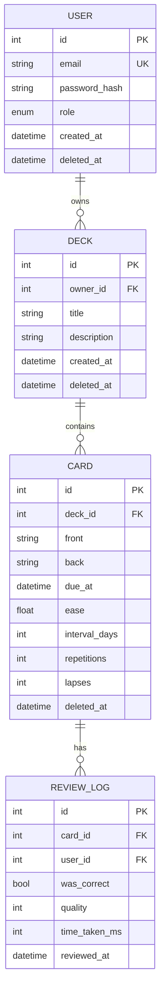

# My App Project Specification

**Team:** 2 (me + 1 partner)
**Stack:** FastAPI + PostgreSQL backend · Kotlin/Compose Android client
**Status:** To be filled in — this is the document we both code against

---

## Why this document exists

**The single most common failure with two people is a disagreement about the interface.** "I assumed you'd return a list, you returned an object" — discovered after both sides are built, costing days.

This document is the contract. **Both of us code against it. Changes go through both of us before either side implements them.**

**Rule: write this document before writing any code. One afternoon. It saves weeks.**

---

## 1. Division of labour

**Split by layer, not by feature.** Splitting by feature produces half-implemented, mismatched, conflicting code.

```
MY HALF                              PARTNER'S HALF
────────                             ─────────────
FastAPI service                      Kotlin + Jetpack Compose
PostgreSQL + migrations              Screens, navigation, state
Business logic (pure, testable)      Retrofit API integration
Authentication, authorisation        Local caching
Tests, CI, deployment                Error and loading states
ML endpoint (Month 5)                Play Store build
```

**Why this split:** my half is 100% Python, which directly serves my internship goals in full-stack and AppSec. Their half teaches mobile development. Neither half is wasted.

**If my partner also wants full-stack,** they should take the Android client while I go deeper on backend and security — then we swap roles for a second project.

---

## 2. Working agreement

**Shared ownership, explicit rules. Agree on these now, while we are still friends.**

| Rule | Reason |
|---|---|
| **Never push directly to `main`** | Every change goes through review |
| `feature/x` → push → PR → review → merge | Catches mistakes before they land |
| Review the other's PR every time | The fastest way to learn |
| Weekly 30-minute sync | Boring but effective |
| GitHub Issues as the task list | Not WhatsApp — we learn the real workflow |
| Agree on "done" now, while we are friends | Not at 2am during finals |

### Definition of Done

Every task is only done when **all** of these are true:

- [ ] Runs on a clean machine from a fresh clone
- [ ] Has at least one test for the core logic
- [ ] Passes CI
- [ ] Reviewed by the other person
- [ ] Documented
- [ ] Merged to `main`

**If it isn't all six, it isn't done.**

---

## 3. What to deliberately avoid

Two people cannot operate distributed systems. Every avoided item is saved debugging time.

| Avoid | Use instead | Why |
|---|---|---|
| Microservices | Modular monolith | Needs 3+ people to operate |
| Redis / Kafka / message queues | Postgres, in-process | Operational overhead, no benefit at our scale |
| Kubernetes | Docker Compose or a PaaS | Enormous overhead |
| Many user roles | One or two roles | Every role multiplies test cases |
| GraphQL | REST | Extra complexity, no need yet |
| Anything needing 24/7 attention | Managed services | Two people cannot |

---

## 4. The API contract

**This is the interface between us. Neither side changes it alone.**

### Conventions

| Aspect | Convention |
|---|---|
| Base URL | `https://<domain>/api/v1` |
| Content-Type | `application/json` |
| Authentication | `Authorization: Bearer <access_token>` |
| Resource naming | Plural nouns: `/decks`, not `/getDeck` |
| Versioning | Path prefix `/api/v1` — breaking changes only |
| Pagination | `?page=N&limit=M`, max 100. Response includes `total` |
| Timestamps | ISO 8601 UTC — `2026-10-02T14:30:00Z` |
| Errors | RFC 9457 problem details |

### Status codes

| Code | When |
|---|---|
| 200 | Successful read or update |
| 201 | Created (`Location` header set) |
| 204 | Deleted (no body) |
| 400 | Malformed syntax |
| 401 | Missing or invalid token |
| 403 | Authenticated but not permitted |
| 404 | Not found, or not visible to the caller |
| 409 | Duplicate or conflict |
| 422 | Validation failed — details in the body |
| 429 | Rate limited — `Retry-After` set |
| 500 | Unexpected — `trace_id` in the body |

### Endpoints

#### POST /api/v1/auth/login

**Request:**
```json
{ "email": "user@example.com", "password": "..." }
```

**200:**
```json
{
  "access_token": "eyJ...",
  "refresh_token": "eyJ...",
  "token_type": "bearer",
  "expires_in": 900
}
```

**401:** generic — never reveals whether the account exists.

---

#### GET /api/v1/decks

**Auth:** required
**Query:** `page` (≥0, default 0) · `limit` (1–100, default 20) · `sort` (`created_at|title|updated_at`)

**200:**
```json
{
  "items": [
    {
      "id": 42,
      "title": "Biology 101",
      "description": "First year modules",
      "card_count": 120,
      "due_count": 8,
      "created_at": "2026-09-01T10:00:00Z"
    }
  ],
  "page": 0,
  "limit": 20,
  "total": 5
}
```

---

#### POST /api/v1/decks

**Request:**
```json
{ "title": "Biology 101", "description": "First year modules" }
```

| Field | Type | Required | Constraints |
|---|---|---|---|
| title | string | yes | 1–120 chars, no control characters |
| description | string | no | ≤ 1000 chars |

**201** + `Location: /api/v1/decks/42`
**422** on validation failure.

---

#### GET /api/v1/decks/{deckId}

**403** when the deck exists but belongs to another user.
**404** when it does not exist.

---

#### PATCH /api/v1/decks/{deckId}

**Request:** any subset of `{title, description}`. **No `id`, no `owner_id`** — they must never be settable.

---

#### DELETE /api/v1/decks/{deckId}

Soft delete. **204.** Remains queryable for 30 days.

---

#### POST /api/v1/decks/{deckId}/cards

**Request:** `{"front": "Capital of Japan?", "back": "Tokyo"}`
**201** on success. **409** on duplicate.

---

#### POST /api/v1/cards/{cardId}/reviews

**Request:** `{"was_correct": true, "quality": 5, "time_taken_ms": 2100}`
| Field | Type | Constraints |
|---|---|---|
| was_correct | bool | required |
| quality | int | 0–5 |
| time_taken_ms | int | 0–3,600,000 |

**200:** the updated card with its new `due_at`.

---

#### GET /api/v1/health

No auth. `{"status": "ok"}`. Used by the load balancer and CI.

---

### Android-side error handling

**Both of us need to know what the client shows for each code:**

| Code | What the app shows |
|---|---|
| 401 | "Session expired — please sign in again" |
| 403 | "You don't have access to this" |
| 404 | "Not found" |
| 409 | "That already exists" |
| 422 | The specific field error from `errors[]` |
| 429 | "Too many attempts — try again shortly" |
| Network failure | "No connection. Showing cached data" + retry button |

---

## 5. Entity-relationship diagram

**Write this before any migration.**



### Relationships and cascade behaviour

| From | To | Cardinality | On delete | Why |
|---|---|---|---|---|
| USER | DECK | 1:M | CASCADE | Deleting a user removes their decks |
| DECK | CARD | 1:M | CASCADE | Deleting a deck removes its cards |
| CARD | REVIEW_LOG | 1:M | CASCADE | History is meaningless without the card |

### Business rules encoded in the schema

| Rule | Mechanism |
|---|---|
| No duplicate emails | `UNIQUE(email)` |
| No duplicate deck titles per owner | `UNIQUE(owner_id, title) WHERE deleted_at IS NULL` |
| Ease never below 1.3 | `CHECK (ease >= 1.3)` |
| Quality always 0–5 | `CHECK (quality BETWEEN 0 AND 5)` |

### Indexes

| Table | Columns | Type | Rationale |
|---|---|---|---|
| cards | `(deck_id, due_at)` | btree, partial on live rows | The main query: due cards for a deck |
| review_logs | `(card_id, reviewed_at)` | btree | Scheduling history |
| users | `(email)` | unique | Login |

**Composite index order matters:** equality column first, range column last.

---

## 6. The MVP scope

**Apply MVP-by-subtraction before we build anything.**

### Step A — Full vision (write everything, filter nothing)

- Create decks · Add cards · Card images
- Spaced-repetition scheduling · Progress charts · Streaks
- Leaderboard with friends · Share decks publicly
- Login with Google · Dark mode · Offline mode
- Push notifications · Admin panel · Premium subscription
- Flashcard marketplace · Search · Tags · Import from CSV

### Step B — Core loop

> **See a card → recall the answer → mark right/wrong → see it again at the right time**

### Step C — Survival test

> *"If I deleted this feature, could the user still study? Would they still use this next week?"*

| Feature | Verdict |
|---|---|
| Create a deck | **KEEP** |
| Add cards (front/back) | **KEEP** |
| Study: show front, reveal back | **KEEP** |
| Mark right / wrong | **KEEP** |
| Schedule the next review | **KEEP** |
| List my decks | **KEEP** |
| Login / account | **LATER** (week 3 — needed once there is more than one user) |
| Search | **CUT** |
| Images | **CUT** |
| Streaks, charts | **CUT** |
| Leaderboard | **CUT** |
| Share publicly | **CUT** |
| Dark mode | **CUT** |
| Notifications | **CUT** |
| CSV import | **CUT** |
| Marketplace | **CUT** |

### Step D — MVP list: 6 features

1. Create a deck
2. Add cards (front and back)
3. List my decks
4. Study: show front, reveal back
5. Mark right or wrong
6. Schedule the next review

### Step E — The 60-second test

A new user must be studying within 60 seconds of opening the app. If they must sign up and configure settings first, we cut too little.

**"Won't have" — written down so we can defend it:** search, images, streaks, charts, leaderboard, public sharing, dark mode, push notifications, CSV import, marketplace, offline mode, admin panel, subscriptions.

---

## 7. Architecture

```
Android (Kotlin/Compose)
        │
        │  HTTPS + JWT
        ▼
┌─────────────────────────────────┐
│  FastAPI                        │
│  ┌───────────────────────────┐  │
│  │  api/routes.py            │  │  HTTP only
│  └────────────┬──────────────┘  │
│               ▼                 │
│  ┌───────────────────────────┐  │
│  │  domain/  (pure logic)     │  │  no framework imports
│  │  services/ (orchestration) │  │
│  └────────────┬──────────────┘  │
│               ▼                 │
│  ┌───────────────────────────┐  │
│  │  repositories/            │  │  ownership baked into queries
│  └────────────┬──────────────┘  │
└───────────────┼─────────────────┘
                ▼
        ┌───────────────┐
        │  PostgreSQL   │
        └───────────────┘
```

**Three layers. One deployable. No microservices.**

### The rule that matters most

> **Business logic lives in `domain/` and imports nothing from FastAPI or SQLAlchemy.**

This is what makes it testable in microseconds with no database running. If the scheduling logic is welded into a route handler, every test needs full infrastructure.

```python
# domain/scheduling.py — pure, no imports from the framework
def schedule_next(current: Schedule, outcome: ReviewOutcome) -> Schedule: ...
```

```python
# tests/unit/test_scheduling.py — instant
def test_first_success_is_one_day(now): ...
```

### Authorisation

**Ownership is part of the query, not a check someone can forget.**

```python
def get_for_user(self, deck_id: int, user_id: int) -> Deck | None:
    return self._session.execute(
        select(Deck).where(Deck.id == deck_id, Deck.owner_id == user_id)
    ).scalar_one_or_none()
```

There is no way to fetch a deck without passing the owner id.

---

## 8. Security requirements

Non-negotiable from day one. Redesigned in, not added later.

- [ ] **Argon2id** password hashing — never plain text, never SHA-256
- [ ] **JWT access tokens**, 15-minute expiry
- [ ] **Refresh token rotation** — single use, reuse detected → revoke the session
- [ ] **Ownership checks on every endpoint**
- [ ] **Parameterised queries only** — no f-string SQL anywhere
- [ ] **Pydantic `extra="forbid"`** — no mass assignment
- [ ] **Rate limiting** on login (5/min per IP, 10/hour per account)
- [ ] **Generic error responses** — no stack traces, no SQL, no file paths
- [ ] **HTTPS everywhere**
- [ ] **`pip-audit` and Bandit in CI**, failing the build on high severity
- [ ] **`.env` gitignored** from commit one
- [ ] **Threat model written** before the first endpoint

### The four security tests (write these for every endpoint that touches data)

```python
def test_cannot_read_another_users_deck(client, other_user_deck): ...
def test_cannot_modify_another_users_deck(client, other_user_deck): ...
def test_mass_assignment_cannot_escalate(client): ...
def test_responses_never_contain_secrets(client): ...
```

---

## 9. Branching and workflow

```
main                    ← always deployable, always green
├── feature/auth        ← short-lived, merged within days
├── feature/decks
└── fix/n-plus-one
```

```bash
git switch -c feature/deck-crud
# work, commit often with good messages
git push -u origin feature/deck-crud
# open a PR, the other person reviews, merge
```

**Good commit messages:**
```bash
# ✗ No information
git commit -m "fixed stuff"

# ✓ Type, scope, what, why
git commit -m "fix(auth): reject already-used refresh tokens

A refresh token could be redeemed twice inside its window,
producing two valid sessions for one login. Added a jti record
and reject reuse. Closes #412."
```

---

## 10. Shipping cadence

**Ship every week.** Even a broken build deployed teaches more than perfect code never released.

```markdown
## Week N — YYYY-MM-DD
- Shipped:
- Bugs found and fixed:
- Blocked by:
- Next week:
```

Deploy early, deploy often, fix in production. **That experience is the point.**

---

## 11. Pre-flight checklist

**Before we call the MVP done:**

- [ ] All 6 MVP features work end to end
- [ ] CI green: lint, types, tests, security scan
- [ ] 20+ tests, 90%+ on the domain layer
- [ ] The four security tests present and passing
- [ ] Deployed with a live URL
- [ ] README a stranger could follow
- [ ] Architecture diagram included
- [ ] Threat model written
- [ ] Every "Won't have" item still cut
- [ ] A real person (not us) has used it and given feedback

---

## 12. Decision log

**Every significant decision, with the reasoning. We will forget why otherwise.**

| Date | Decision | Reasoning | Considered alternatives |
|---|---|---|---|
| 2026-10-02 | FastAPI over Django | Type hints, async, smaller surface, explicit | Django (batteries included, more magic), Flask (too bare) |
| 2026-10-02 | Modular monolith over microservices | Two people cannot operate distributed systems | Microservices, serverless functions |
| 2026-10-02 | REST over GraphQL | Simpler, well understood, better caching | GraphQL (over-fetching not a real problem at our scale) |

---

## 13. Open questions

**To resolve in week 1:**

- [ ] What exactly does the app do? (one sentence, in `01_MY_6_MONTH_ROADMAP.md`)
- [ ] Do we need accounts in the MVP, or hardcode a single user for now?
- [ ] Which scheduling algorithm — SM-2 or FSRS?
- [ ] Where do we host the backend?
- [ ] What is our deploy process?
- [ ] What do we call it?

**Resolve these before writing code.** An unanswered question here becomes a disagreement later.
