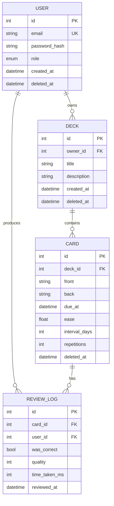
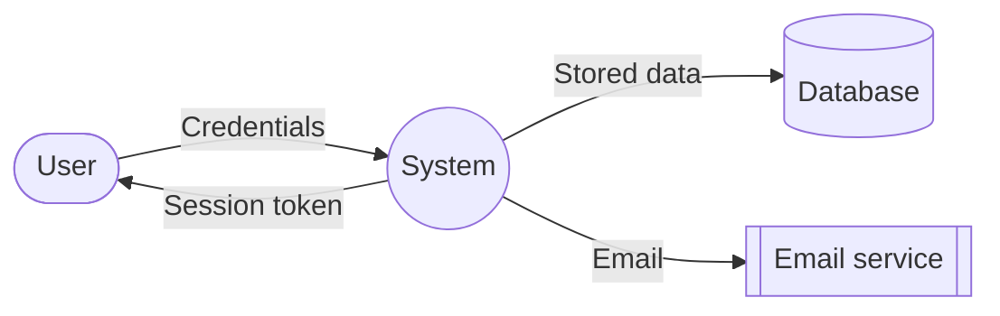
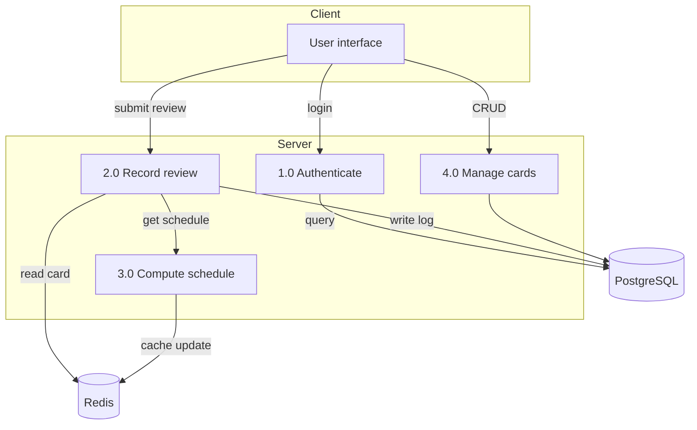
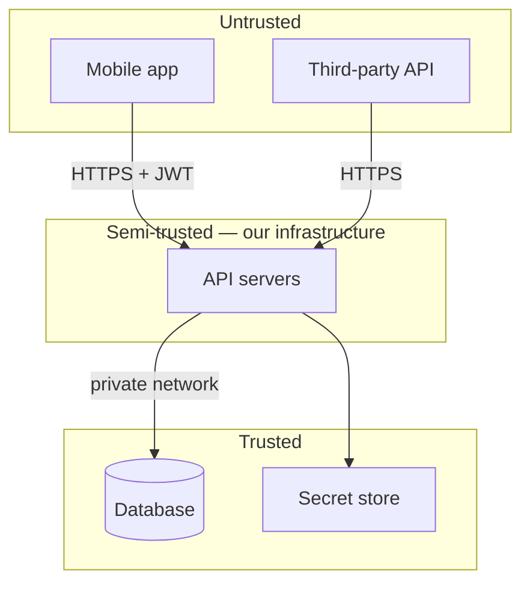

# Project Document Templates

Fill-in templates for every document described in Part 14 of `01_SOFTWARE_ENGINEERING_FIELD_GUIDE.md`.

**How to use these:** copy the template into your project as `docs/01-project-charter.md`, fill every section, and commit it. Delete any section that genuinely does not apply — but do not delete one just because it is inconvenient.

**The rule for every document:** write it for a **specific reader with a specific question**. "Who is reading this, and what do they need to decide?" If you cannot answer that, do not write it yet.

---

## Table of Contents

- [T01 — Project charter](#t01--project-charter)
- [T02 — Requirements specification](#t02--requirements-specification)
- [T03 — Use case specification](#t03--use-case-specification)
- [T04 — Entity-relationship diagram spec](#t04--entity-relationship-diagram-spec)
- [T05 — Data flow diagram spec](#t05--data-flow-diagram-spec)
- [T06 — Architecture decision record](#t06--architecture-decision-record)
- [T07 — API specification](#t07--api-specification)
- [T08 — Threat model](#t08--threat-model)
- [T09 — Test plan](#t09--test-plan)
- [T10 — Risk register](#t10--risk-register)
- [T11 — Sprint planning](#t11--sprint-planning)
- [T12 — README](#t12--readme)
- [T13 — Code review checklist](#t13--code-review-checklist)
- [T14 — Changelog](#t14--changelog)
- [T15 — Post-mortem](#t15--post-mortem)
- [T16 — Deployment runbook](#t16--deployment-runbook)
- [T17 — Adr log](#t17--adr-log)

---

# T01 — Project charter

**Reader:** everyone, especially new team members and reviewers.
**File:** `docs/01-project-charter.md`

```markdown
# <Project Name> — Project Charter

## One-line pitch
<!-- If you cannot write this in one sentence, you do not have a project yet. -->

## Problem
<!-- What pain exists today? Who has it? How often? What does it cost them?
     Prefer evidence over assumption: "we interviewed 12 students and 9 said X". -->

## Target users
<!-- Be specific. "University students" is weak. "Second-year CS students preparing
     for final exams who use Anki but find its scheduling confusing" is usable. -->

## Success metrics
<!-- How will you know this worked? Numeric and time-bounded. -->

## Scope

### In scope (v1)
-
-
-

### Out of scope (explicitly)
<!-- The most important section. Written "Won't have" items here are the
     primary defence against scope creep. -->
-
-

## Constraints
<!-- Budget, deadline, team size, skills, mandated technologies, regulations -->

## Key assumptions
<!-- Each one, with how you will validate it. An assumption you have not
     validated is the most likely cause of project failure. -->

| Assumption | Validation method | Validated when |
|---|---|---|
| | | |

## Risks
<!-- Link to T10 — Risk Register -->

## Tech stack
<!-- With a one-line justification each. Link to ADRs in T06. -->

| Layer | Choice | Why |
|---|---|---|
| Language | | |
| Web framework | | |
| Database | | |
| Deployment | | |

## Milestones

| Date | Milestone | Deliverable |
|---|---|---|
| | | |

## Open questions
<!-- Things you do not know yet. Review at each sprint planning. -->

-
```

---

# T02 — Requirements specification

**Reader:** developers building it, QA testing it, the client confirming scope, regulators if applicable.
**File:** `docs/02-requirements.md`

```markdown
# <Project Name> — Requirements Specification

Version: 1.0
Last updated: YYYY-MM-DD
Author:

## 1. Introduction
### 1.1 Purpose
### 1.2 Scope
### 1.3 Definitions and abbreviations
### 1.4 References

## 2. Overall description
### 2.1 Product perspective (how it fits in the larger system)
### 2.2 User characteristics (technical skill level, frequency of use)
### 2.3 Constraints
### 2.4 Assumptions and dependencies

## 3. Functional requirements

<!-- Number every requirement. A testable requirement has an ID.
     Format: FR-<module>-<n>
     Each MUST state observable behaviour, not implementation. -->

| ID | Requirement | Priority | Acceptance criterion |
|---|---|---|---|
| FR-AUTH-1 | The system shall authenticate a user with email and password | Must | Given valid credentials, a session is created and the user sees their dashboard |
| FR-DECK-1 | The system shall allow a user to create a deck | Must | A user with 1 card can create a deck with title between 1 and 120 characters |
| FR-DECK-2 | The system shall display only decks owned by the requesting user | Must | A user requesting another user's deck ID receives 403 |
| FR-STUDY-1 | The system shall compute the next review date using the FSRS algorithm | Must | Given a card with a review history, the next review date matches the algorithm's output |
| FR-STUDY-2 | The system shall allow the user to mark a card correct or incorrect | Must | ... |
| | | Should | |
| | | Could | |
| | | Won't | |

### 3.x Business rules
<!-- Invariants that must always hold. These are the most important requirements. -->

| ID | Rule |
|---|---|
| BR-1 | A card's next review date shall always be strictly in the future after a review |
| BR-2 | A user shall never see a deck they do not own |
| BR-3 | A review shall never modify another user's card |

## 4. Non-functional requirements

<!-- The section everyone skips and everyone pays for. Make each MEASURABLE. -->

### 4.1 Performance
| ID | Requirement | Measurement method |
|---|---|---|
| NFR-PERF-1 | p95 API response time < 300ms for read endpoints | Load test with k6, 100 VUs |
| NFR-PERF-2 | Page load < 2s on a 3G connection | Lighthouse, mid-range Android |
| NFR-PERF-3 | Study screen renders the next card in < 100ms | Client-side measurement |

### 4.2 Scalability
| ID | Requirement |
|---|---|
| NFR-SCALE-1 | Support 10,000 concurrent users without response time degradation |
| NFR-SCALE-2 | Support 100,000 cards in a single deck without query timeout |

### 4.3 Availability
| ID | Requirement |
|---|---|
| NFR-AVAIL-1 | 99.5% uptime monthly (≈3.6 hours downtime) |
| NFR-AVAIL-2 | The application shall recover from a single instance failure without downtime |

### 4.4 Security
| ID | Requirement |
|---|---|
| NFR-SEC-1 | Passwords stored using Argon2id; plaintext never persisted or logged |
| NFR-SEC-2 | All traffic over TLS 1.2+ |
| NFR-SEC-3 | Every endpoint enforces authentication and object-level authorization |
| NFR-SEC-4 | No known high-severity CVEs in dependencies (enforced by pip-audit in CI) |
| NFR-SEC-5 | Rate limiting on login: 5/minute per IP, 10/hour per account |
| NFR-SEC-6 | User data exportable and deletable on request |

### 4.5 Usability
| ID | Requirement |
|---|---|
| NFR-USE-1 | A new user reaches their first study session within 60 seconds |
| NFR-USE-2 | All destructive actions require explicit confirmation |

### 4.6 Accessibility
| ID | Requirement |
|---|---|
| NFR-A11Y-1 | WCAG 2.1 AA: contrast ratio ≥ 4.5:1 for all text |
| NFR-A11Y-2 | All interactive elements reachable and operable via keyboard/screen reader |
| NFR-A11Y-3 | No information conveyed by colour alone |

### 4.7 Maintainability
| ID | Requirement |
|---|---|
| NFR-MAINT-1 | Business logic covered by automated tests at ≥90% |
| NFR-MAINT-2 | A new developer can run the project locally within 10 minutes using the README |
| NFR-MAINT-3 | Every module has a single documented entry point |

### 4.8 Compatibility
| ID | Requirement |
|---|---|
| NFR-COMPAT-1 | Supports Android 8.0 (API 26) and above |
| NFR-COMPAT-2 | Works on Chrome, Firefox, Safari latest two versions |

### 4.9 Compliance
| ID | Requirement |
|---|---|
| NFR-COMP-1 | Complies with the Data Privacy Act (RA 10173) |

## 5. Out of scope
<!-- Explicitly excluded. Protects the schedule. -->
-

## 6. Traceability matrix
<!-- Maps every requirement to where it is implemented and tested.
     This is what makes verification possible. -->

| Requirement ID | Implemented in | Tested by |
|---|---|---|
| FR-DECK-2 | `app/decks/routes.py:get_deck` | `tests/integration/test_deck_access.py::test_cannot_read_another_users_deck` |
| FR-STUDY-1 | `app/reviews/domain.py:schedule_next` | `tests/unit/test_scheduling.py` |

## 7. Appendix
```

---

# T03 — Use case specification

**Reader:** developers implementing, QA writing test cases.
**File:** `docs/use-cases/UC-XXX.md`

```markdown
# UC-XXX: <Action name>

| | |
|---|---|
| **ID** | UC-XXX |
| **Name** | |
| **Actor** | Primary / Secondary |
| **Priority** | Must / Should / Could |
| **Preconditions** | |
| **Postconditions** | |
| **Trigger** | |

## Main flow (success)
1. <System> does X
2. <Actor> does Y
3. <System> responds with Z
   - **Validation:** what if the input is invalid?
   - **Business rule:** what rule applies here?
   - **Persistence:** what is stored?
4. ...

## Alternative flows
| # | Condition | Response |
|---|---|---|
| 3a | The deck is empty | Display "No cards yet" with a call to action |
| 3b | The user has no due cards | Display "Next review: <date>" |
| 3c | Network failure | Display an error with a retry action |

## Exception flows
| # | Condition | Response |
|---|---|---|
| 5a | Database unavailable | Return 503; log the error; client retries with backoff |
| 5b | Not authenticated | Return 401 with a login prompt |

## Business rules applied
- BR-1, BR-3

## Acceptance criteria
<!-- Given / When / Then. Directly convertible into test cases. -->

**AC-1**
- Given a user with a deck containing 10 due cards
- When they start a study session
- Then 10 cards are returned, ordered by due date ascending

**AC-2**
- Given a user with a deck containing no due cards
- When they attempt to start a study session
- Then the system displays the next scheduled review date

## Non-functional considerations
- Response time: < 300ms p95
- Works offline: no
- Requires authentication: yes

## Test cases derived from this
| Test | Type |
|---|---|
| `test_start_session_returns_due_cards_in_order` | integration |
| `test_start_session_with_no_due_cards_shows_date` | integration |
| `test_start_session_requires_authentication` | integration |
```

---

# T04 — Entity-relationship diagram spec

**Reader:** whoever builds the schema, and anyone writing queries against it.
**File:** `docs/03-data-model.md`

Write this **before** writing any migration. Every "the database is wrong" bug is usually a missing agreement here.

```markdown
# <Project Name> — Data Model

## Convention
- Boxes = entities, diamonds = relationships, ovals = attributes
- PK = primary key, FK = foreign key, UQ = unique constraint

## Diagram

<!-- Mermaid renders directly in most Markdown viewers -->



## Entity descriptions

### USER
| Field | Type | Null | Default | Constraints | Description |
|---|---|---|---|---|---|
| id | int | no | auto | PK | |
| email | str(255) | no | | UQ, lowercased | Login identifier |
| password_hash | str(255) | no | | | Argon2id |
| role | enum | no | 'viewer' | | |
| created_at | timestamptz | no | now() | | |
| deleted_at | timestamptz | yes | null | | Soft delete |

**Validation rules:** email must be a valid address, ≤255 chars. Password 12–128 chars.

### Relationships

| From | To | Cardinality | On delete | Rationale |
|---|---|---|---|---|
| USER | DECK | 1:M | CASCADE | Deleting a user removes their decks |
| DECK | CARD | 1:M | CASCADE | Deleting a deck removes its cards |
| CARD | REVIEW_LOG | 1:M | CASCADE | Review history is meaningless without the card |

**On delete CASCADE vs. RESTRICT matters.** A review log should be deleted with its card. But if review logs were ever financial records, you would need RESTRICT.

## Business rules encoded in the schema

| Rule | Mechanism |
|---|---|
| A user cannot have two decks with the same title | UNIQUE (owner_id, title) WHERE deleted_at IS NULL |
| No duplicate emails | UNIQUE on email |
| A review must reference an existing card | FOREIGN KEY |

## Indexes

| Table | Index | Columns | Type | Rationale |
|---|---|---|---|---|
| cards | idx_cards_deck_due | (deck_id, due_at) | btree | The main query: due cards for a deck |
| review_log | idx_review_card_date | (card_id, reviewed_at DESC) | btree | Scheduling history |
| users | idx_users_email | (email) | unique | Login lookup |

## Data retention

| Data | Retention | Deletion method |
|---|---|---|
| Deleted accounts | 30 days | Hard delete after the window |
| Review logs | Life of account | Cascade on user delete |
| Backups | 30 days | Automatic expiry |
```

---

# T05 — Data flow diagram spec

**Reader:** architects, analysts, whoever needs to understand where data moves.
**File:** `docs/04-data-flow.md`

```markdown
# <Project Name> — Data Flow Diagrams

## Level 0 — Context



## Level 1 — Processes



## Process specifications

### P1.0 Authenticate

| | |
|---|---|
| **Input** | email, password |
| **Validation** | Format, length, not in blocklist |
| **Process** | Hash compare against stored Argon2id hash |
| **Output** | Session token, or 401 with a generic message |
| **Data store** | users |
| **Security** | Constant-time comparison; generic error to prevent enumeration; rate limited 5/min |
| **Failure modes** | DB unavailable → 503; malformed input → 422 |

## Data dictionary

| Data element | Type | Source | Destination | Retention |
|---|---|---|---|---|
| Email | string | User input | users.email | Life of account |
| Password | string | User input | **Never stored** — hashed immediately | n/a |
| Session token | string | Generated | Client, Redis | 24h, sliding |
| Review outcome | enum + int | User input | review_logs | Life of account |
```

---

# T06 — Architecture decision record

**Reader:** your future self and any new team member. Six months from now you will not remember why.
**File:** `docs/adr/NNNN-short-title.md`

```markdown
# ADR-0001: Use PostgreSQL rather than MongoDB

- **Status:** Accepted
- **Date:** 2026-10-02
- **Deciders:**
- **Technical area:** Data storage

## Context
<!-- What forces are at play? What is the actual problem? -->

The application stores highly relational data: users own decks, decks contain cards,
cards have review histories. Reporting requires joining across all four. The data
volume at launch is small (est. 10,000 rows in year one).

## Decision
<!-- What did we decide? State it in one sentence, unambiguously. -->

Use PostgreSQL as the primary datastore, with SQLAlchemy for data access.

## Alternatives considered

| Option | Advantages | Disadvantages | Why rejected |
|---|---|---|---|
| PostgreSQL (chosen) | Relational integrity, ACID transactions, mature tooling, one system for everything | Schema migrations needed | — |
| MongoDB | Flexible schema, simple scaling | Weak joins, harder referential integrity | Data is relational; we would fight the model |
| Both | Flexibility everywhere | Two systems, two backup strategies, more operational burden | No requirement justifies it |

## Consequences

### Positive
- Strong referential integrity on ownership
- Transactions span multiple tables
- One database skill rather than two
- Managed Postgres is cheap and available everywhere

### Negative
- Schema changes require migrations (manageable with Alembic)
- Horizontal scaling is harder than a document store (not needed at this scale)

### Risks
- If the data model becomes unexpectedly hot, write throughput could become a
  constraint. Mitigation: revisit at 10M rows; consider partitioning by hash.

## Links
- Requirements: NFR-SCALE-2
- Diagram: docs/03-data-model.md
```

---

# T07 — API specification

**Reader:** frontend developers, partner teams, QA.
**File:** `docs/05-api.md`

```markdown
# <Project Name> — API Specification

Base URL: https://api.example.com/api/v1
Content-Type: application/json
Authentication: Bearer token in the `Authorization` header

## Conventions

| Aspect | Convention |
|---|---|
| Resource naming | Plural nouns: `/decks`, not `/getDeck` |
| Versioning | Path prefix `/api/v1`. Breaking changes only |
| Pagination | `?page=N&limit=M`, max limit 100. Response includes `total` |
| Timestamps | ISO 8601 UTC: `2026-10-02T14:30:00Z` |
| Errors | RFC 9457 problem details |
| Idempotency | `Idempotency-Key` header required on POST /payments |

## Status codes

| Code | Meaning | When |
|---|---|---|
| 200 | OK | Successful read or update |
| 201 | Created | Resource created; `Location` header set |
| 204 | No Content | Successful delete |
| 400 | Bad Request | Malformed syntax |
| 401 | Unauthorized | Missing or invalid token |
| 403 | Forbidden | Authenticated but not permitted |
| 404 | Not Found | Resource does not exist or is not visible to the caller |
| 409 | Conflict | Duplicate or state conflict |
| 422 | Unprocessable | Validation failed; details in the body |
| 429 | Too Many Requests | Rate limited; `Retry-After` set |
| 500 | Internal Server Error | Unexpected; `trace_id` in the body |

## Endpoints

### GET /decks

List decks owned by the authenticated user.

**Auth:** required
**Query parameters:**

| Name | Type | Default | Constraints |
|---|---|---|---|
| page | int | 0 | ≥ 0 |
| limit | int | 20 | 1–100 |
| sort | enum | created_at | created_at, title, updated_at |

**200 Response:**
```json
{
  "items": [
    {"id": 42, "title": "Biology 101", "card_count": 120, "due_count": 8,
     "created_at": "2026-09-01T10:00:00Z"}
  ],
  "page": 0,
  "limit": 20,
  "total": 5
}
```

**Errors:** 401, 422

---

### POST /decks

**Auth:** required
**Request body:**
```json
{"title": "Biology 101", "description": "First year modules"}
```

| Field | Type | Required | Constraints |
|---|---|---|---|
| title | string | yes | 1–120 chars, no control characters |
| description | string | no | ≤ 1000 chars |

**201 Response:** `Location: /api/v1/decks/42`
**422 Response:**
```json
{
  "type": "https://api.example.com/errors/validation",
  "title": "Validation failed",
  "status": 422,
  "detail": "The request body failed validation",
  "errors": [{"field": "title", "message": "String should have at least 1 character"}],
  "trace_id": "a1b2c3d4"
}
```

---

### GET /decks/{deckId}

**Authorization:** the deck must be owned by the caller.
**403 Response** when the deck exists but is owned by someone else.
**404 Response** when the deck does not exist.

---

### DELETE /decks/{deckId}

Soft delete. Returns 204. The deck remains queryable by admins for 30 days.

---

### POST /decks/{deckId}/cards

**Body:** `{"front": "...", "back": "..."}`
**Errors:** 403, 404, 409 (duplicate), 422

---

### POST /cards/{cardId}/reviews

**Body:** `{"was_correct": true, "quality": 5, "time_taken_ms": 2100}`
**Returns:** the updated card with its new `due_at`.

---

### GET /health

No auth. Returns `{"status": "ok"}`. Used by the load balancer and CI.

---

## Authentication flow

```
POST /auth/login  {"email", "password"}
  → 200 {"access_token", "refresh_token", "expires_in"}
  → 401 generic error (never reveals whether the account exists)

POST /auth/refresh  (refresh token in body or cookie)
  → 200 new token pair (the old refresh token is invalidated)

POST /auth/logout
  → 204 (session revoked server-side)
```

**Access tokens:** 15 minutes. **Refresh tokens:** 30 days, single-use, rotated on each refresh.
```

---

# T08 — Threat model

**Reader:** developers implementing controls, security reviewers, auditors.
**File:** `docs/06-threat-model.md`

```markdown
# <Project Name> — Threat Model

Date:
Author:
Review date:

## 1. System description
<!-- One paragraph. Include a link to the architecture diagram. -->

## 2. Assets
<!-- What is worth protecting? Rank by what a breach would cost. -->

| Asset | Value | Classification |
|---|---|---|
| User credentials | Account takeover | Critical |
| Study history | User's academic progress | High |
| Personal email | Identity, PII | High |
| Deck content | User's work | Medium |

## 3. Trust boundaries



## 4. STRIDE analysis

| # | Element | Threat | Scenario | Impact | Likelihood | Control | Status |
|---|---|---|---|---|---|---|---|
| 1 | Client → API | Spoofing | Forged JWT with modified claims | Full account takeover | Medium | Signature verification, HS256 hardcoded, `require` claims | Implemented |
| 2 | API → DB | Tampering | User A modifies User B's deck | Data breach | High | Ownership in the SQL query, RLS policy | Implemented |
| 3 | POST /cards | Elevation | PATCH body includes `{"role":"admin"}` | Privilege escalation | Medium | Pydantic schema with no `role` field; `extra="forbid"` | Implemented |
| 4 | All endpoints | Info disclosure | Stack trace returned on error | Exposes internals | Medium | Global handler returning a generic message plus `trace_id` | Implemented |
| 5 | GET /decks | Information disclosure | Enumerate deck IDs to read others' data | Data breach | High | Ownership check returns 403 | Implemented |
| 6 | POST /auth/login | Denial of service | 10k requests/min per IP | Lockout of legitimate users | High | Rate limit 5/min per IP, 10/hr per account | Implemented |
| 7 | Search | Injection | SQL injection via search term | Full DB read | Medium | Parameterised queries only; `text()` never used with f-strings | Implemented |
| 8 | File upload | Tampering | Upload a PHP file, execute it | Remote code execution | Low | UUID filenames, `nosniff`, served from a cookieless domain | Implemented |
| 9 | Third-party API | Tampering | Malicious response injected | Data corruption | Low | Schema-validate every response with Pydantic | Implemented |
| 10 | Admin actions | Repudiation | Admin deletes a deck, denies it | Unprovable dispute | Medium | Append-only audit log with hash chaining | Planned |

## 5. Accepted risks

<!-- The section everyone skips, and the one that matters most. -->

| Risk | Why accepted | Review date | Owner |
|---|---|---|---|
| No CAPTCHA on login | Rate limiting is sufficient at current scale. Revisit if credential stuffing is observed | 2026-12-01 | |
| No MFA | Not yet holding sensitive data. Required before launch if the app stores health information | 2026-11-01 | |
| SQLite-like local cache not encrypted | Contains only public deck content, cleared on logout | 2026-12-01 | |

## 6. Review triggers
<!-- This model must be revisited when: -->
- A new external integration is added
- Sensitive data categories change (e.g. health data)
- An incident occurs
- The deployment model changes
- Six months pass
```

---

# T09 — Test plan

**Reader:** whoever writes the tests, and whoever signs off on quality.
**File:** `docs/07-test-plan.md`

```markdown
# <Project Name> — Test Plan

## 1. Objectives
<!-- What does this plan prove? What is explicitly out of scope? -->

## 2. Test levels

| Level | Scope | Tools | Coverage target | Runs |
|---|---|---|---|---|
| Unit | Pure logic, no I/O | pytest | ≥ 90% of domain layer | Every commit |
| Integration | Route → service → repository → real DB | pytest + TestClient + Postgres | ≥ 75% of API layer | Every PR |
| E2E | Full user journey | pytest + TestClient (or Playwright) | All critical paths | Before release |
| Security | OWASP Top 10 checks | pytest, Bandit, pip-audit | All 4 core tests | Every PR |
| Performance | Load under expected peak | k6 / Locust | p95 < 300ms | Before release |

## 3. Test cases

### Functional
| ID | Requirement | Test | Type | Status |
|---|---|---|---|---|
| TC-01 | FR-DECK-2 | Cannot read another user's deck | integration | Automated |
| TC-02 | FR-STUDY-1 | Schedule matches algorithm output | unit | Automated |

### Security (write these four for every app)
| ID | Check | Test |
|---|---|---|
| SEC-01 | SQL injection in every parameter | `test_injection_attempts_are_rejected` |
| SEC-02 | Object-level authorization on every endpoint | `test_cannot_read_another_users_<resource>` |
| SEC-03 | Mass assignment cannot escalate privileges | `test_role_cannot_be_set_via_patch` |
| SEC-04 | No secrets in any response or log | `test_responses_never_contain_secrets` |

### Edge cases
- Empty input, single element, maximum size, maximum value
- Unicode, emoji, RTL text, very long strings
- Concurrent access to the same record
- Network failure mid-request
- Clock skew between client and server

## 4. Test data

| Dataset | Source | PII | Notes |
|---|---|---|---|
| Users | Factory function | None | Generated per test |
| Decks | Factory function | None | |
| Performance seed | `scripts/seed.py` | None | 10k users, 100k cards |

## 5. Environment

| Environment | Database | Data | Purpose |
|---|---|---|---|
| Local | Docker Postgres, ephemeral | Seeded | Development |
| CI | Postgres service container, ephemeral | None | Automated tests |
| Staging | Staging DB | Seeded, anonymised | E2E, performance |

## 6. Entry and exit criteria

**Entry to release testing:** all unit and integration tests green; coverage ≥ 80%; no known high-severity security findings; migrations tested on a production-like database.

**Exit from release testing:** all critical-path E2E tests pass; no open severity-1 or severity-2 defects; p95 latency within target; rollback verified.

## 7. Defect management

| Severity | Definition | Response |
|---|---|---|
| 1 — Critical | Data loss, breach, complete outage | Fix before release |
| 2 — High | Core feature broken, no workaround | Fix before release |
| 3 — Medium | Feature broken, workaround exists | Fix within 2 weeks |
| 4 — Low | Cosmetic | Backlog |
```

---

# T10 — Risk register

**Reader:** the project owner. Reviewed at every planning session.
**File:** `docs/08-risks.md`

```markdown
# Risk Register

Scoring: Likelihood (1–5) × Impact (1–5) = Score. Anything ≥ 12 needs active mitigation.

| ID | Risk | Category | L | I | Score | Mitigation | Owner | Status |
|---|---|---|---|---|---|---|---|---|
| R-01 | Nobody wants the app | Product | 3 | 5 | 15 | Test with 5 users before building beyond the core loop | | Open |
| R-02 | Scope creep | Process | 4 | 4 | 16 | Written "Won't have" list; nothing enters a sprint without owner approval | | Open |
| R-03 | The scheduling algorithm performs worse than a simple baseline | Technical | 3 | 4 | 12 | Benchmark against the baseline before committing to the approach | | Open |
| R-04 | Third-party API is discontinued or changes | Technical | 2 | 4 | 8 | Wrap it in an adapter; keep the interface minimal | | Open |
| R-05 | Personal burnout (solo project) | Resource | 3 | 4 | 12 | Ship something small and real rather than something large and unfinished | | Open |
| R-06 | Store rejection | Process | 2 | 4 | 8 | Follow guidelines from day 1; budget two resubmissions | | Open |
| R-07 | Dataset unavailable or unusable | Technical | 3 | 5 | 15 | Verify availability and licensing in week 1 | | Closed — confirmed |
| R-08 | Secrets committed to git | Security | 2 | 5 | 10 | Pre-commit hooks; secret scanning in CI | | Mitigated |

## Review
Reviewed on: YYYY-MM-DD
Next review: YYYY-MM-DD
```

---

# T11 — Sprint planning

**Reader:** the team, and future readers reconstructing how the project evolved.
**File:** `docs/sprints/sprint-01.md`

```markdown
# Sprint 01 — <Goal>

| | |
|---|---|
| **Dates** | YYYY-MM-DD to YYYY-MM-DD |
| **Goal** | <!-- One sentence. What will be different at the end? --> |
| **Team** | |
| **Scrum Master** | |
| **Product Owner** | |

## Sprint backlog

| # | Task | Owner | Estimate | Status | Requirement |
|---|---|---|---|---|---|
| 1 | Write the ERD and confirm with the team | | 3h | Done | — |
| 2 | Implement the Card entity and its migrations | | 5h | Done | FR-CARD-1 |
| 3 | Implement `schedule_next` with unit tests | | 8h | In progress | FR-STUDY-1 |
| 4 | Set up CI with lint, types, tests | | 3h | Done | NFR-MAINT-1 |
| 5 | | | | | |

## Definition of Done
- [ ] Runs on a clean machine from a fresh clone
- [ ] Has tests covering the core logic
- [ ] Passes CI (lint, types, tests, security scan)
- [ ] Reviewed and merged via pull request
- [ ] Documented in the README or code docstrings

## Sprint review notes
<!-- What was demonstrated. What feedback did stakeholders give? -->

## Retrospective
| Category | Notes |
|---|---|
| What went well | |
| What was difficult | |
| What we will change | |
| Action items | |

## Carried over
<!-- Anything not finished, and why. Carried-over work is a signal — three
     consecutive sprints of carry-over means the estimates or the scope are wrong. -->
```

---

# T12 — README

**Reader:** a recruiter who has never seen your code, and a new developer. They have about 30 seconds of patience.
**File:** `README.md`

```markdown
# <Project Name>

<!-- One-sentence description. What it does and for whom. -->


**Try it:** [Live URL] · **Report a bug:** [Issues]

## What it does

<!-- Three to five bullets. The user-facing value, not the feature list. -->

## Why it exists

<!-- The problem, in two or three sentences. Optional but valuable. -->

## Tech stack

| Layer | Technology | Why this choice |
|---|---|---|
| Backend | Python 3.12, FastAPI | Type hints, async, fast to build correctly |
| Database | PostgreSQL 16 | Relational data, ACID, mature tooling |
| Auth | JWT + Argon2id | Stateless API, memory-hard hashing |
| Frontend | Kotlin, Jetpack Compose | Native Android experience |
| CI/CD | GitHub Actions | Free, integrated with GitHub |
| Deployment | Render + Neon | Managed, minimal operational burden |

## Architecture

<!-- ASCII diagram. Keep it under 15 lines. -->

```
Client ──HTTPS──▶ API ──▶ Domain (pure logic)
                    │
                    ├────▶ PostgreSQL (source of truth)
                    └────▶ Redis (cache)
```

**Key design decisions:**
- Business logic is pure and framework-independent, so it is tested without infrastructure
- Authorization is enforced in the data access layer, not in route handlers
- Migrations use expand-and-contract, so deployments never break

## Getting started

### Prerequisites
- Python 3.12+
- Docker Desktop
- [Anything else]

### Run locally

```bash
git clone https://github.com/<user>/<repo>.git
cd <repo>
cp .env.example .env        # then fill in the values
docker compose up -d        # starts Postgres, Redis, and the API
```

The API is now running at http://localhost:8000 — see http://localhost:8000/docs for the interactive API documentation.

### Run tests

```bash
uv run pytest                        # everything
uv run pytest tests/unit -m "not slow"   # the fast suite
uv run pytest --cov --cov-report=html
```

### Project layout

```
app/
├── main.py            FastAPI app factory
├── config.py          Settings from the environment
├── api/               Routes — HTTP only, no business logic
├── domain/            Pure business logic, zero technology imports
├── repositories/      Database access
└── security/          Auth, hashing, authorization
tests/
├── unit/              No infrastructure needed
└── integration/       Real database via containers
```

## Features

- [x] Feature one
- [x] Feature two
- [ ] Feature three (planned — see docs/02-requirements.md)

## Testing and quality

- **CI:** every push runs lint, type check, tests, and a security audit
- **Coverage:** 87% overall, 94% on the domain layer
- **Security:** Argon2id password hashing, ownership checks on every endpoint, rate limiting, no known CVEs (enforced by `pip-audit`)

## Documentation

- [Requirements](docs/02-requirements.md) · [Data model](docs/03-data-model.md) · [API](docs/05-api.md) · [Threat model](docs/06-threat-model.md) · [Architecture decisions](docs/adr/)

## Contributing

Issues and pull requests are welcome. Please run `pre-commit install` before your first commit.

## Licence

MIT
```

---

# T13 — Code review checklist

**Reader:** the reviewer.
**File:** `.github/pull_request_template.md`

```markdown
## What this changes
<!-- What does this PR do, and why? Link the ticket. -->

## How it was tested
<!-- What did you run? What did you check by hand? -->

## Checklist

### Correctness
- [ ] The change does what the ticket says, and nothing more
- [ ] Edge cases handled (empty, one, maximum, negative, unicode)
- [ ] Error paths return useful, non-leaking messages

### Design
- [ ] Logic is in the right layer — routes are HTTP only
- [ ] Business logic has no framework or database imports
- [ ] Naming is clear; no single-letter names outside loops
- [ ] No duplication that should be a shared function

### Security
- [ ] No secrets committed
- [ ] All input validated at the boundary
- [ ] All queries parameterised — no f-string SQL
- [ ] Authorization checked on the server for every affected endpoint
- [ ] New fields are not user-settable
- [ ] No sensitive data in logs

### Tests
- [ ] New behaviour is covered
- [ ] Failure paths are tested, not just the happy path
- [ ] Tests assert on behaviour, not implementation details
- [ ] The suite passes locally

### Documentation
- [ ] README updated if user-facing behaviour changed
- [ ] ADR added if an architectural decision was made
- [ ] Public functions have docstrings explaining *why*, not just *what*

## Screenshots
<!-- For any UI change. -->
```

---

# T14 — Changelog

**Reader:** users deciding whether to upgrade, and future maintainers.
**File:** `CHANGELOG.md`

```markdown
# Changelog

All notable changes to this project are documented here.
The format follows [Keep a Changelog](https://keepachangelog.com/en/1.1.0/),
and this project adheres to [Semantic Versioning](https://semver.org/).

## [Unreleased]
### Added
-
### Changed
-
### Fixed
-
### Security
-

## [1.5.0] — 2026-10-02

### Added
- Deck sharing between users (#412)
- Bulk card import from CSV (#418)

### Changed
- Review scheduling now uses FSRS instead of SM-2 (#390)
- Search is 40% faster — removed an N+1 query in the deck listing

### Fixed
- Cards with empty backs no longer crash the study session (#421)
- Review log timestamps were off by one day in non-UTC timezones (#405)

### Security
- Rate limiting on the login endpoint
- Ownership checks added to three endpoints that were missing them (#419)

**Upgrade notes:**
1. Run `alembic upgrade head` **before** deploying the new code — this release
   adds a nullable column and does not drop anything.
2. Rollback is safe, but keep the previous image until 2026-10-09.

## [1.4.0] — 2026-09-14
### Added
-
```

---

# T15 — Post-mortem

**Reader:** the whole team, and future you. Blameless.
**File:** `docs/postmortems/YYYY-MM-DD-incident.md`

```markdown
# Post-mortem: <Short incident title>

- **Date:** YYYY-MM-DD
- **Duration:** HH:MM
- **Severity:** 1–4
- **Status:** Resolved

## Summary
<!-- Two or three sentences. What broke, for how long, and who was affected. -->

## Impact
| | |
|---|---|
| Users affected | |
| Requests failed | |
| Data loss | None / describe |
| Financial | |
| SLO burn | |

## Timeline
<!-- Times in UTC. Be precise — precision is what reveals the cause. -->

| Time | Event |
|---|---|
| 09:14 UTC | Deployment of v1.4.2 completed |
| 09:22 UTC | Error rate alert fired (5xx > 1% for 2 min) |
| 09:31 UTC | On-call acknowledged |
| 09:38 UTC | Root cause identified |
| 09:52 UTC | Rollback initiated |
| 09:55 UTC | Error rate returned to normal |
| 10:10 UTC | Incident closed |

## Root cause
<!-- Not "someone made a mistake." Why did the system allow a mistake to
     have production impact? -->

## Contributing factors
- The migration ran automatically on deploy with no staging verification
- No integration test covered this path
- The rollback took 17 minutes because the runbook had the wrong command

## What went well
- The alert fired within 8 minutes
- The on-call was reachable
- Rollback was possible

## What went badly
- No staging gate
- The runbook was wrong
- We had no monitoring on this specific error

## Action items
<!-- Every item needs an owner and a date. Unowned action items do not happen. -->

| # | Action | Owner | Due | Status |
|---|---|---|---|---|
| 1 | Add an integration test covering the migration path | | | Open |
| 2 | Require staging verification before production migration | | | Open |
| 3 | Correct the runbook and test it during the next deploy | | | Open |
| 4 | Add an alert for this error class | | | Open |

## Lessons
<!-- One or two generalisable statements. -->
```

---

# T16 — Deployment runbook

**Reader:** whoever is on call at 3am. Assume they are tired and have never done this before.
**File:** `docs/runbook.md`

```markdown
# <Project Name> — Operations Runbook

## Service overview
| | |
|---|---|
| Production URL | |
| Dashboard | |
| Error tracking | |
| Logs | |
| Repository | |
| Hosting | |

## Health checks
```bash
curl -s https://api.example.com/api/health          # expect {"status":"ok"}
curl -s https://api.example.com/api/health/ready     # checks the database too
```

## Deploy
```bash
# 1. Confirm CI is green on the exact commit
# 2. Tag the release
git tag -a v1.5.0 -m "Release 1.5.0"
git push origin v1.5.0        # this triggers the deploy pipeline

# 3. Watch it
#    - CI pipeline
#    - Platform deploy log
#    - Error rate and p95 latency for 15 minutes

# 4. Smoke test
curl --fail https://api.example.com/api/health
```

## Rollback
```bash
# Re-deploy the previous tag — this is the primary rollback path
# Platform dashboard → Deployments → select previous → Redeploy

# If a migration must be reverted (only if it was purely additive):
alembic downgrade -1

# If the database is corrupted:
#   1. Stop all writes (scale to zero)
#   2. Restore from the most recent backup
#   3. Verify row counts against the pre-incident snapshot
#   4. Scale back up
```

## Common incidents

### Error rate above 1%
1. Check the last deploy — roll back if one happened in the last hour
2. Check `p95 latency` — a spike suggests resource exhaustion or a slow query
3. Check database CPU — a spike suggests a missing index or an N+1
4. Check third-party dependency status pages

### Elevated p95 latency
1. Identify the slow endpoint from the metrics dashboard
2. Check for a slow query in the database log
3. Check cache hit rate — a drop means the cache restarted
4. Scale up if CPU-bound

### Users report being logged out
1. Check whether the signing key changed — an env var was rotated incorrectly
2. Check the token TTL — it may have been set to an unintended value

## Escalation
| Situation | Contact |
|---|---|
| Database issue | DBA on call |
| Security incident | Security lead |
| Hosting outage | Platform support |
| Everything else | Project owner |

## Routine maintenance
| Task | Frequency |
|---|---|
| Review error tracking | Daily |
| Review dependency updates | Weekly |
| Restore-test backups | Monthly |
| Review access and rotate credentials | Quarterly |
| Full security review | Annually |
```

---

# T17 — ADR log

**Reader:** anyone looking for the reasoning behind a technical choice.
**File:** `docs/adr/README.md`

```markdown
# Architecture Decision Records

An ADR captures a decision that is significant enough that a future reader
would ask "why did we do it this way?"

| # | Title | Status | Date | Deciders |
|---|---|---|---|---|
| 0001 | Use PostgreSQL rather than MongoDB | Accepted | 2026-10-02 | |
| 0002 | Modular monolith rather than microservices | Accepted | 2026-10-02 | |
| 0003 | Domain logic isolated from framework code | Accepted | 2026-10-02 | |
| 0004 | JWT access tokens with server-side refresh rotation | Accepted | 2026-10-05 | |
| 0005 | | Superseded by ADR-0012 | | |

## Status values
- **Proposed** — under discussion
- **Accepted** — decided and in effect
- **Superseded by ADR-NNNN** — replaced
- **Deprecated** — no longer relevant, but not replaced

## When to write an ADR
Write one when the decision:
- Is hard to reverse later
- Affects more than one module or team
- Has real trade-offs, not an obvious answer
- Would be non-obvious to a new team member
- Was a genuine disagreement worth recording

## When NOT to write one
- The choice is trivially reversible
- Only one module is affected
- There was no real alternative considered
```

---

## How to use these templates

1. **Copy the ones you need into `docs/`.** Not all of them apply to every project.
2. **Fill them in order.** Charter → requirements → data model → architecture → API → threat model → test plan.
3. **Commit them.** They are as much a part of the deliverable as the code.
4. **Update them when reality changes.** A document that disagrees with the code is worse than no document.
5. **Fill them in with the real values.** A template with `<placeholder>` text in it demonstrates nothing to anyone.

The most valuable single document in this set is the **ADR log**. It is small, cheap to maintain, and it is what demonstrates engineering maturity faster than anything else in a repository.
