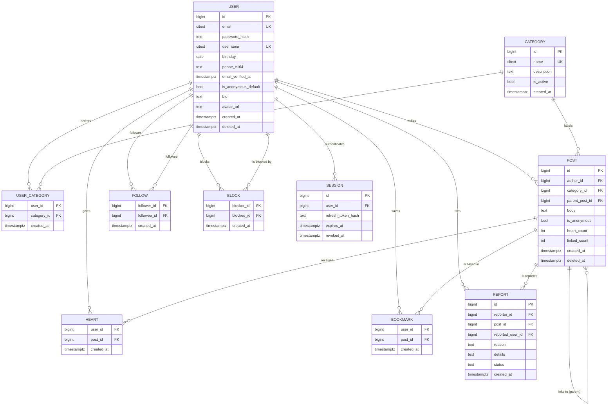

# Konek'ta — Product and Requirements Specification

**Team:** 2 (me + 1 partner)
**Stack:** FastAPI + PostgreSQL backend · Kotlin / Jetpack Compose Android client
**Source idea:** [`../Konek'ta.txt`](../Konek'ta.txt)
**Status:** Draft v1 — both partners must read and agree before any code is written
**Last updated:** 2026-10-13

---

## How to use this document

| If you are… | Read |
|---|---|
| Deciding what to build | Part 2 (vision), Part 8 (MVP scope) |
| Writing backend code | Part 3 (domain model), Part 4 (FRs), Part 5 (feed rules) |
| Writing Android code | Part 4 (FRs), Part 6 (screen map) |
| Reviewing a pull request | Part 8 (MVP list), Part 14 (decision log) |
| Looking for what is still undecided | Part 13 (open questions) |

**The rule:** this document is the contract. Neither side changes it alone. A change
happens by agreeing here first, then implementing. If the code and this document
disagree, the code is wrong.

**Companion documents:**

- [`../MY_PLAN/02_MY_APP_PROJECT_SPEC.md`](../MY_PLAN/02_MY_APP_PROJECT_SPEC.md) — working agreement, division of labour, API conventions, Definition of Done
- [`../TEMPLATES/01_PROJECT_DOCUMENT_TEMPLATES.md`](../TEMPLATES/01_PROJECT_DOCUMENT_TEMPLATES.md) — the blank templates this document is shaped from
- [`../TEMPLATES/02_PYTHON_CODE_PATTERNS.md`](../TEMPLATES/02_PYTHON_CODE_PATTERNS.md) — backend code shape
- [`../GUIDES/01_SOFTWARE_ENGINEERING_FIELD_GUIDE.md`](../GUIDES/01_SOFTWARE_ENGINEERING_FIELD_GUIDE.md) Part 2 and Part 3 — how MVP scoping and requirements work, and why

---

## Table of contents

| Part | Contents |
|---|---|
| **1** | [Introduction](#part-1--introduction) — purpose, scope, definitions, references |
| **2** | [Product vision](#part-2--product-vision) — pitch, problem, principles, personas, core loop |
| **3** | [Domain model](#part-3--domain-model) — entities, the link mechanic, ERD, business rules, indexes |
| **4** | [Functional requirements](#part-4--functional-requirements) — FR-001 … FR-038 with acceptance criteria |
| **5** | [Feed and ranking rules](#part-5--feed-and-ranking-rules) — the deterministic algorithm, pagination, exclusions |
| **6** | [Screen map](#part-6--screen-map) — every screen, navigation graph |
| **7** | [Non-functional requirements](#part-7--non-functional-requirements) — performance, security, privacy, safety, accessibility |
| **8** | [MVP scope by subtraction](#part-8--mvp-scope-by-subtraction) — what ships, what does not, and why |
| **9** | [Architecture](#part-9--architecture) — brief shape and the one rule that matters |
| **10** | [Privacy, safety and compliance](#part-10--privacy-safety-and-compliance) — PII, anonymity, abuse, donations warning |
| **11** | [Traceability matrix](#part-11--traceability-matrix) — every line of the .txt maps to a requirement |
| **12** | [Risks](#part-12--risks) — what could sink this, and the mitigation |
| **13** | [Open questions](#part-13--open-questions) — must be answered before build week 1 |
| **14** | [Decision log](#part-14--decision-log) — every decision and its reasoning |
| **15** | [Appendix](#part-15--appendix) — seed categories, glossary |

---

# Part 1 — Introduction

## 1.1 Purpose

This document turns [`Konek'ta.txt`](../Konek'ta.txt) from a list of ideas into a
specification two people can build from without arguing.

The `.txt` file answers *what might this app do*. It does not answer, and cannot
answer:

- What is the core loop — the one action a user repeats?
- Which features ship in v1, and which are cut?
- What does "linked post" actually mean in the database?
- What does the feed algorithm do, exactly, and is it testable?
- What happens when two users have the same username?
- What is *not* in scope, written down so we can defend it?

**Every ambiguity resolved here is a future argument avoided.**

## 1.2 Scope

### In scope for this document

- Product vision, principles, personas, and the core loop
- The domain model and its business rules
- Functional requirements with acceptance criteria
- The feed ranking rule, stated precisely enough to unit-test
- Non-functional requirements
- MVP scope, decided by subtraction
- Privacy, safety, and compliance obligations
- Open questions and the decisions already taken

### Not in scope for this document

- Endpoint-by-endpoint API contract → [`../MY_PLAN/02`](../MY_PLAN/02_MY_APP_PROJECT_SPEC.md) §4, written after this document is agreed
- Kotlin/Compose UI implementation details
- CI/CD, deployment, hosting choices
- Marketing, launch strategy, pricing

## 1.3 Definitions and abbreviations

| Term | Meaning in this document |
|---|---|
| **Post** | A single piece of text written by a user. Has exactly one category. May optionally link to one parent post. |
| **Linked post** | A post that credits another post as its origin. The mechanic that replaces comments. See §3.2. |
| **Parent post** | The post a linked post points to. One post has at most one parent. |
| **Thread** | The set of posts sharing a root parent: the parent itself plus all posts linking to it, recursively. |
| **Category** | The single taxonomy used for both user interests and post labelling. See §3.1.2. |
| **Interest** | A user's relationship to a category. "I follow Gaming" = a `user_categories` row. |
| **For You** | The relevance feed. Posts in the reader's interest categories, newest first. |
| **Explore** | The discovery feed. Anything, filterable by category. |
| **Following** | Posts by accounts the reader follows. |
| **Heart** | A like. One per reader per post. Toggleable. |
| **Bookmark** | A private save. Visible only to the reader. |
| **Pseudonymous** | Posting under a chosen handle without linking to a legal identity. Konek'ta's default. |
| **Anonymity toggle** | The reader-controlled setting that makes *your own* posts pseudonymous. MVP feature (FR-034). |
| **Reveal mechanic** | An app-chosen rule that automatically exposes who a pseudonymous user really is. **Not in MVP.** See §3.3. |
| **MVP** | Minimum viable product. The smallest thing that delivers the core loop. |
| **FR-xxx** | Functional requirement. A numbered, testable statement of required behaviour. |
| **NFR-xxx** | Non-functional requirement. A numbered quality constraint. |
| **BR-xxx** | Business rule. An invariant that must always hold. |
| **PII** | Personally identifiable information. |
| **ADR** | Architecture decision record. |

## 1.4 References

| Reference | Used for |
|---|---|
| [`../Konek'ta.txt`](../Konek'ta.txt) | The original idea. Traceability in Part 11. |
| `../MY_PLAN/02_MY_APP_PROJECT_SPEC.md` §1–3 | Division of labour, working agreement, Definition of Done |
| `../MY_PLAN/02` §4 | REST conventions, status codes, pagination style |
| `../TEMPLATES/01_PROJECT_DOCUMENT_TEMPLATES.md` T02, T03, T04 | The structure of Parts 3, 4, 7 |
| `../TEMPLATES/01` T08 | The threat model, to be written before the first endpoint |
| `../GUIDES/01_SOFTWARE_ENGINEERING_FIELD_GUIDE.md` Part 2 | MVP by subtraction |
| `../GUIDES/01` Part 3 | Why non-functional requirements are written down early |
| `../GUIDES/03_SECURITY_ENGINEERING_GUIDE.md` | Sections 4 and 10 feed the requirements in Part 7 |
| `../GUIDES/06_ARCHITECTURE_AND_SYSTEM_DESIGN.md` | Keyset pagination for feeds |
| `../GUIDES/04_TESTING_AND_QA_GUIDE.md` | Acceptance criteria → test cases |

---

# Part 2 — Product vision

## 2.1 One-sentence pitch

> **Konek'ta is a feed where you only ever see topics you actually care about, and
> where you respond to someone's post by writing your own linked post instead of
> commenting.**

## 2.2 The problem

Every mainstream social feed is chronological-plus-engagement. You follow a hundred
people, half of whom post about things you do not care about, and the algorithm
promotes whatever maximises time-on-app rather than what you asked for. The result
is a product that knows a great deal about you and almost nothing about what you
want to read.

**Konek'ta's claim is narrow and testable:** the feed contains nothing outside the
categories the reader selected at registration, and the reader can always see why
they were shown each post.

Three specific things go wrong in existing apps that this product fixes:

| Problem | Existing behaviour | Konek'ta's answer |
|---|---|---|
| **Irrelevance** | Engagement-ranked feed surfaces whatever provokes reaction | Feed is a hard filter on the reader's interests |
| **Black-box ranking** | "Why am I seeing this?" is unanswerable | Every post shows its reason: "because you follow Gaming" |
| **Reply collapse** | Comments degrade into noise, flame wars, and engagement bait | Replying means writing a post. Quality over volume. |

## 2.3 Product principles

These are the rules that resolve arguments. When two options are defensible, the
one closer to these principles wins.

### P1 — Relevance over reach

A post from a stranger in a category you selected beats a post from a celebrity
outside every category you selected. **Engagement never overrides relevance.**

> Implication: there is no "trending", no "discover more of this", no boost paid for
> by advertisers, in v1. If a feature would let content reach a reader outside their
> interests to make someone happy, it is cut.

### P2 — Every response is a post

There are no comments. To respond, you write a post that links to the one you are
responding to.

> Implication: one creation surface, one content type, one ranking system. The entire
> conversation lives in the feed and is ranked by the same rules as everything else.
> This is why Konek'ta has no comment table, no comment notifications, and no
> comment moderation queue.

### P3 — Explain every ranking decision

If the feed shows a post, the reader can see the category that put it there.

> Implication: FR-012 is not a nice-to-have. A ranking system the user cannot audit
> cannot be trusted, and an unauditable system is indistinguishable from engagement
> ranking — which is what this product exists to be unlike.

### P4 — Pseudonymous by default

Users post under a handle. Real identity is not required and is never shown by the
system without the user's own action.

> Implication: no legal-name field, no identity document upload, no automatic
> de-anonymisation. See §3.3 and §10.

### P5 — Small surface, fully working

Text only. No media, no direct messages, no comments. Everything that ships is
finished, tested, and handles its error states.

> Implication: the hardest things in this product are ranking relevance and the link
> mechanic. Both are pure logic and both are testable in microseconds. Media
> pipelines and abuse-prone messaging features are not, and they are the usual
> reason a two-person project dies in month three.

### P6 — Publish the decisions, not just the code

Anything written here that a partner could discover later and disagree with gets
written down now.

## 2.4 Users

### Primary — The Narrowed Reader

Has a small number of specific interests, is annoyed by the noise in existing feeds,
and will leave permanently if the feed shows off-topic content even once. Opens
daily to check what appeared in their topics.

**They do not care** about follower counts, trending topics, or being popular. They
care about signal.

### Secondary — The Contributor

Writes posts because they have something to say about their topic, and wants the
post to be found by people who share the interest rather than by an algorithm.

**They care about** being seen by the right readers, and about being credited when
someone builds on their post.

### Tertiary — The Connector

The main reason the app is called Konek'ta ("let's connect"). Does not post much,
but hearts, bookmarks, follows, and links posts. This is the user who makes the
core loop worth running.

### Explicitly not a target in v1

| Not targeting | Why |
|---|---|
| Businesses and brands | Would require ads or sponsored content. Both violate P1. |
| Media creators and influencers | Success is measured by reach; this app optimises for relevance instead. |
| Under-13 users | Excluded by the age gate. See §13 Q-1. |
| Users seeking anonymity for harmful reasons | Pseudonymity here is a product default for ordinary conversation, not protection for abuse. Report and block still apply. |

## 2.5 The core loop

> **Read a post in a topic you follow → it makes you think of something → you write a
> linked post → the people who follow that topic see it → they link back, heart, or
> follow you.**

Each arrow is a feature that must exist for the loop to close:

| Step | Feature | Requirement |
|---|---|---|
| Read a post in a topic you follow | For You feed, filtered by interests | FR-009 |
| It makes you think of something | No comments — you write a whole post instead | P2, FR-016 |
| You write a linked post | Composer with an optional parent post | FR-015, FR-016 |
| The right people see it | Your interests match theirs | FR-009, FR-018 |
| They engage back | Heart, bookmark, follow | FR-020 … FR-023 |

### The survival test

> *"If this feature did not exist, could a reader still complete the loop, and would
> they come back tomorrow?"*

If the answer is no, it is core. If yes, it is deferred. Applied mechanically, this
test is what produced the MVP list in Part 8.

### What happens when the loop is broken

The loop has one dependency that is **not** in our control: **there must be posts to
read.** On day one, a user registers, picks interests, and sees an empty feed.

This is the single largest risk in the product and it has no technical fix. It has a
content answer, and it must be planned before launch:

| Mitigation | Detail |
|---|---|
| Seed content at launch | 200–500 posts across the top 20 categories, from named founding accounts. |
| Closed beta first | 30–50 invited users, then 5 more per week. |
| Invite before feed | Registration requires an invite code or is preceded by an explicit "your feed is empty, here are the topics" state. |
| Instrument empty-feed rate | If a user's first session shows zero posts, that is a failure to solve, not a user problem. Track it. |

**This is logged as R-1 in Part 12 and as Q-7 in Part 13.**

## 2.6 How Konek'ta differs

| | Chronological | Engagement-ranked | Konek'ta |
|---|---|---|---|
| Decides what you see | Who posted most recently | What provokes the most reaction | What matches topics you selected |
| Off-topic posts reach you | Constantly | Constantly, as "discovery" | **Never** |
| Can you see why? | Sort order is visible | Opaque, deliberately | Always, per post |
| Replying to a post | Comment | Comment | **Write a linked post** |
| Identity | Legal name required | Legal name required | **Pseudonymous by default** |
| Optimises for | Recency | Time on app | **Your stated interests** |

---

# Part 3 — Domain model

**Write this before any migration.** The schema is the argument that cannot be
argued later without a migration.

## 3.1 The core entities

### 3.1.1 The five that matter

| Entity | What it is | Why it exists |
|---|---|---|
| `USER` | One account | Identity, credentials, settings |
| `CATEGORY` | One topic in a single flat taxonomy | The unit of relevance for both reading and labelling |
| `USER_CATEGORY` | A user's interest in a category | The filter behind the For You feed |
| `POST` | One piece of text, one category, optional parent | The only content type |
| `POST_LINK` | A post's link to a parent post | The mechanic that replaces comments |

Everything else — reactions, bookmarks, follows, blocks, reports, sessions — is a
small table attached to these five.

### 3.1.2 One taxonomy, not two

The `.txt` file mentions two related things: **interests** (chosen at registration)
and **categories** (attached to a post). Treating these as separate vocabularies is
a mistake, because it guarantees two lists to keep in sync and two ways for a post
to be invisible to a reader who follows the "right" word.

**Decision: one flat `CATEGORY` table.** A user's interests are the rows in
`USER_CATEGORY`. A post's label is a foreign key to the same table.

```
CATEGORY ──┬──< USER_CATEGORY >── USER        (this is an interest)
           │
           └──< POST                          (this is a post's label)
```

Consequences:

- A reader follows *Gaming* and a post labelled *Gaming* reaches them. One word, one meaning.
- No mapping table, no synonym list, no "why didn't I see this?" bug.
- Categories are flat in v1. No hierarchy, no nested topics. If subtopics are needed
  later, `parent_id` on `CATEGORY` is the change, and it does not affect `POST`.

**How many categories?** Enough that any single user's interests are a genuine
subset — around 60–80 at launch. Fewer and every user follows most of them, which
makes the relevance filter meaningless. More and the picker becomes a search box.

**Who can create a category?** In v1, **admins only**. If users could create
categories freely, the taxonomy fragments into synonyms and near-duplicates within a
week, and the filter stops meaning anything. Open to users once there is a
merge/alias mechanism — logged as Q-5.

### 3.1.3 User

| Field | Type | Notes |
|---|---|---|
| `id` | bigint PK | |
| `email` | citext **UNIQUE** | Case-insensitive. Login and recovery. |
| `password_hash` | text | Argon2id. Never reversible. |
| `username` | citext **UNIQUE** | The handle shown on posts. 3–24 chars, `[a-z0-9_]`. |
| `birthday` | date | Stored as a date, used only to derive age. Never returned by any endpoint. |
| `phone_e164` | text NULL | Recovery and 2FA only. Never returned. See §10. |
| `email_verified_at` | timestamptz NULL | |
| `is_anonymous_default` | bool | The anonymity toggle. Default `true`. FR-034. |
| `bio` | text NULL | ≤ 280 chars. Optional. |
| `avatar_url` | text NULL | Optional profile picture. FR-028. |
| `created_at` | timestamptz | |
| `deleted_at` | timestamptz NULL | Soft delete for account erasure. §10. |

**There is no `real_name` field.** A pseudonymous product that stores legal names
has a data breach that ends the product. If a future feature needs a verified
identity, it needs a separate, access-controlled table with a documented purpose —
not a nullable column on `USER`.

### 3.1.4 Post

| Field | Type | Notes |
|---|---|---|
| `id` | bigint PK | |
| `author_id` | bigint FK → `USER` | |
| `category_id` | bigint FK → `CATEGORY` | Exactly one. Not nullable. |
| `parent_post_id` | bigint FK → `POST` NULL | Set when this post links another. Self-reference. |
| `body` | text | 1–2000 chars. |
| `is_anonymous` | bool | Copied from the author's setting at creation. |
| `heart_count` | int | Denormalised cache. See below. |
| `linked_count` | int | Denormalised cache. Number of posts linking to this one. |
| `created_at` | timestamptz | |
| `deleted_at` | timestamptz NULL | Soft delete. |

**No `title`.** A 2000-character limit on a text post means a title is a line of body
text that everyone has to scroll past. TikTok-style apps do not have titles and the
`.txt` does not ask for one.

**No `edited_at` in v1.** No post editing. If a post is wrong, the author deletes it
and reposts. Editing a post breaks the meaning of every linked post pointing at it —
the reader followed a link to a specific piece of text and the text changed underneath
them. Decision logged as DEC-09.

**Why `parent_post_id` and not a join table:** a post links to *at most one* parent.
One nullable self-referencing foreign key expresses that, enforces it in the
database, and makes "show me this thread" a single indexed query. A join table would
allow multiple parents and permit cycles, both of which are meaningless here.

**Why the counters are denormalised:** `heart_count` and `linked_count` are read on
every feed row and written on every interaction. Counting with a subquery per row is
the classic N+1 and the single slowest thing a feed can do. They are caches, and
they must be corrected by a reconciliation job or a documented procedure — see
BR-08.

### 3.1.5 The link mechanic

This is the defining feature. It gets its own section because it is the easiest
thing to get subtly wrong.

```
Post A (author: @mara, category: Gaming)
  "Finally finished the 40-hour build I'd been avoiding all year."
        ▲
        │  Post B links to Post A
        │
Post B (author: @dev, category: Gaming)
  "Same. What broke it for me was doing the UI last instead of first."
        │
        │  Post C links to Post B
        │
Post C (author: @kai, category: Gaming)
  "Counterpoint — doing UI last is fine if you scope it to one screen."
```

Post C links to Post B, which links to Post A. The reader following the thread walks
backwards from C to B to A and sees the whole exchange as **posts in the feed**, each
ranked by the same interest filter as everything else.

**Why this is better than comments, concretely:**

| | Comments | Linked posts |
|---|---|---|
| Ranking | One ranking system (the parent) | Every post in the thread is ranked independently |
| Reach | Bounded by the parent's audience | A good reply reaches everyone following that category |
| Quality | Effortless one-word replies | 2000 characters and a deliberate category choice |
| Moderation | A comment section to moderate per post | One content pipeline, already built |
| Ranking exploit | | Collapsed by design — see BR-04 |

**BR-01.** A post links to at most one parent.
**BR-02.** A post cannot link to itself.
**BR-03.** The root of a thread is a post with `parent_post_id IS NULL`.
**BR-04.** Linking is limited to **3 levels deep**. A deeper chain is rejected with
422. Without this, a thread becomes an unbounded traversal on every thread view, and
a cycle — even with the self-link check — becomes a denial-of-service on the endpoint.
This is the single most important business rule in the model.

**BR-05.** Linking is **attribution, not republication.** The linked post's full text
is never copied. The child stores a reference; the parent can always be deleted
without corrupting the child. This is why `ON DELETE SET NULL` is used for
`parent_post_id` — see §3.4.

## 3.2 Anonymity: two different things, only one in the MVP

The `.txt` file contains two anonymity ideas. They are easy to confuse and must not
be.

### 3.2.1 The anonymity toggle — IN the MVP

A reader-controlled setting that determines whether *your own* posts display your
username or a pseudonym.

- `FR-034`, in MVP, cheap, one boolean per user and one per post.
- It is a display choice. It hides nothing from the platform — the server always
  knows the author, moderation always applies.
- It does not imply any protection. A pseudonymous account is still reportable and
  blockable, and its content is still subject to the rules in Part 10.

### 3.2.2 The reveal mechanic — NOT in the MVP

> *"There might be an option of showing the real identity of the user based on the
> interactivity."*

Read plainly: a user posts under a pseudonym, and **the system automatically reveals
who they really are** to another user once some interaction threshold is passed —
after exchanging several linked posts, or after a mutual follow.

**Recommendation: cut it from v1 and do not build the automatic version later.**

| Reason | Detail |
|---|---|
| **It is a de-anonymisation feature** | The product would be shipping a feature whose purpose is to strip one person's privacy. That is how people get identified, doxxed, and harassed. |
| **Interaction depth is not consent** | Exchanging posts with someone does not mean you agreed to be identified to them. Consent to interact and consent to be identified are different permissions. |
| **The abuse surface is the whole audience** | A reveal that fires after a mutual follow can be engineered: follow 200 people, get 200 reveals, now 200 people know your identity. |
| **It destroys P4 on both sides** | It makes pseudonymous posting a lie for the users most likely to need it. |
| **It needs real moderation you do not have** | Genuine identity disclosure requires report, review, appeal, and a legal basis for handling identifying data. That is a support organisation, not a feature. |

**Safe alternative, for whenever it is built:** reveal is always **user-controlled**.
A user may at any time choose to display a verified display name to accounts they
interact with. Nothing is automatic. No legal identity is ever stored or shown — only
a display name the user chose, which can be changed or withdrawn instantly.

Logged as DEC-05.

## 3.3 Entity-relationship diagram

**Write this before any migration.**



## 3.4 Relationships and cascade behaviour

| From | To | Cardinality | On delete | Why |
|---|---|---|---|---|
| USER | POST | 1:M | CASCADE | Deleting an account removes its posts |
| USER | USER_CATEGORY | 1:M | CASCADE | No orphan interests |
| CATEGORY | USER_CATEGORY | 1:M | RESTRICT | A category in use cannot be deleted; deactivate instead |
| CATEGORY | POST | 1:M | RESTRICT | Same — posts always have a category |
| POST | POST | 1:M | **SET NULL** | Deleting a parent orphans its children; they survive as roots. Never CASCADE — that would let one deletion wipe a thread |
| USER | HEART | 1:M | CASCADE | |
| POST | HEART | 1:M | CASCADE | |
| USER | BOOKMARK | 1:M | CASCADE | |
| POST | BOOKMARK | 1:M | CASCADE | |
| USER | FOLLOW | 1:M | CASCADE | Both columns |
| USER | BLOCK | 1:M | CASCADE | Both columns |
| POST | REPORT | 1:M | **RESTRICT** | Reports are evidence and must outlive the post |
| USER | SESSION | 1:M | CASCADE | |

**`SET NULL` on `parent_post_id` is deliberate and it is what makes BR-05 true.** If
the author of Post A deletes it, Post B — which linked to A — must survive and
simply become a root post. `CASCADE` here would silently delete an entire discussion
because one person hit delete.

**`RESTRICT` on reports** is the second one that matters. Reports are the only
record that abuse happened. If they cascade-delete with the post, deleting a post
erases the evidence of why it was reported.

## 3.5 Business rules encoded in the schema

Rules that can be enforced by the database **must** be, not by application code.

| Rule | Mechanism |
|---|---|
| No duplicate emails | `UNIQUE(email)` on citext |
| No duplicate usernames | `UNIQUE(username)` on citext |
| Every post has exactly one category | `category_id` NOT NULL + FK |
| A post has at most one parent | Single nullable column |
| No self-links | `CHECK (parent_post_id <> id)` |
| Threads max 3 levels | Enforced in the service layer (needs a read) — BR-04 |
| Body is 1–2000 characters | `CHECK (char_length(body) BETWEEN 1 AND 2000)` |
| No duplicate hearts | `PRIMARY KEY (user_id, post_id)` |
| No self-follow | `CHECK (follower_id <> followee_id)` |
| No self-block | `CHECK (blocker_id <> blocked_id)` |
| No duplicate interests | `PRIMARY KEY (user_id, category_id)` |
| No duplicate follow | `PRIMARY KEY (follower_id, followee_id)` |
| Counts never negative | `CHECK (heart_count >= 0 AND linked_count >= 0)` |
| An email is verified once | `CHECK (email_verified_at IS NULL OR email_verified_at > created_at)` |

**On the uniqueness of a handle:** a taken username returns **409 with the same
generic body** as an unknown username during recovery flows. A "that email is
registered" message on a login form is a free account-enumeration oracle.

## 3.6 Indexes

Indexes follow from the queries in Part 5. An index not justified by a query is
write overhead.

| Table | Columns | Type | The query it serves |
|---|---|---|---|
| `posts` | `(category_id, created_at DESC, id DESC)` | btree | **The For You feed.** The hot query. Equality on category, range on time. |
| `posts` | `(author_id, created_at DESC)` | btree | Profile, own posts |
| `posts` | `(parent_post_id, created_at ASC)` | btree | Thread view |
| `posts` | `(created_at DESC, id DESC)` | btree, partial `WHERE deleted_at IS NULL` | Explore feed |
| `posts` | `(heart_count DESC)` | btree, partial | Admin/reconciliation only |
| `user_categories` | `(category_id, user_id)` | btree | "Does this reader follow this category" |
| `hearts` | `(post_id)` | btree | Aggregate counts, reconciliation |
| `hearts` | PK `(user_id, post_id)` | — | Toggle, and the read that powers "is this hearted by me" |
| `bookmarks` | `(user_id, created_at DESC)` | btree | Saved posts list |
| `follows` | `(followee_id, follower_id)` | btree | The Following feed |
| `sessions` | `(refresh_token_hash)` | **unique** | Token lookup on every refresh |
| `reports` | `(status, created_at)` | btree | Moderation queue |

**Composite index column order matters.** Equality columns first, range columns
last: `(category_id, created_at DESC)` because category is an equality test and
`created_at` is the sort. Reversing it destroys the index's usefulness for the feed.

## 3.7 The hardest query, written out

The For You feed is the product. Here is exactly what it must do, before Part 5
turns it into requirements.

```sql
-- For You: posts in the reader's interest categories, newest first.
-- Keyset pagination on (created_at, id) so page 50 costs the same as page 1.
SELECT p.id, p.body, p.category_id, p.is_anonymous,
       p.heart_count, p.linked_count, p.created_at,
       p.parent_post_id,
       u.username,
       c.name AS category_name
  FROM posts p
  JOIN users u    ON u.id = p.author_id AND u.deleted_at IS NULL
  JOIN categories c ON c.id = p.category_id AND c.is_active
 WHERE p.deleted_at IS NULL
   AND p.category_id IN (
         SELECT category_id FROM user_categories WHERE user_id = :reader_id)
   AND p.author_id <> :reader_id          -- your own posts are not your feed
   AND p.id NOT IN (                       -- never show someone who blocked you
         SELECT post_id FROM blocks WHERE blocker_id = :reader_id)
   AND p.author_id NOT IN (               -- and never show someone you blocked
         SELECT blocked_id FROM blocks WHERE blocker_id = :reader_id)
   AND ( :cursor_ts IS NULL                -- keyset predicate, absent on page 1
         OR (p.created_at, p.id) < (:cursor_ts, :cursor_id) )
   AND p.id NOT IN (                       -- do not show a post twice if the
         SELECT parent_post_id             -- reader follows two of its categories
         FROM posts WHERE parent_post_id IS NOT NULL )
 ORDER BY p.created_at DESC, p.id DESC
 LIMIT 20;
```

Four decisions in there are worth defending:

| Decision | Why |
|---|---|
| `p.id NOT IN (SELECT parent_post_id FROM posts ...)` | If a reader follows both Cooking and Recipes, a post appears once, under one of them. Without this the feed double-posts, and a duplicated feed is the fastest way to lose a reader's trust. |
| Excluding the reader's own posts | Your own posts live on your profile. A feed that shows you yourself is a feed with nothing to do. |
| Keyset pagination, not `OFFSET` | `OFFSET 5000` makes the database count and discard 5000 rows. Feeds are read on every open, and this is the query that would fall over first. See `../GUIDES/06_ARCHITECTURE_AND_SYSTEM_DESIGN.md`. |
| No joins to `hearts` or `bookmarks` | Whether the reader has hearted or saved a post is returned as a boolean per row, computed in one batched query for the 20 returned ids. One extra round trip, not 40. |

---

# Part 4 — Functional requirements

## 4.1 How to read these

| Field | Meaning |
|---|---|
| **ID** | Stable reference. Never renumber — retired IDs are recorded, not reused. |
| **Story** | As a `[role]`, I want `[action]` so that `[benefit]`. |
| **Priority** | `MVP` — ships in v1 · `MVP (proposed)` — ships in v1, see §8.3 for the proposal · `LATER` — deferred, written down so it is not lost |
| **AC** | Acceptance criteria, Given/When/Then. These become test cases (`../GUIDES/04_TESTING_AND_QA_GUIDE.md`). |

**The numbering is dense.** FR-002, FR-008, and FR-015 are not used. That is
intentional — an ID that was considered and rejected should never be reused for
something else, or old references silently point at the wrong requirement.

---

## 4.2 Account and identity

### FR-001 — Landing page

**Priority:** MVP

**Story:** As a first-time visitor, I want to understand what Konek'ta is in about
fifteen seconds, so that I know whether to register.

**Description.** A full-screen introductory experience in the style the `.txt`
describes as "like TikTok". One idea per screen, swipeable, at most three to five
screens. Ends in exactly two actions: **Create account** and **Sign in**.

**AC**
1. Given a signed-out visitor, when the app opens, then the landing flow is shown, not the feed.
2. Given any landing screen, when the user acts, then Create account and Sign in are always reachable without scrolling through all screens.
3. Given a registered user who has signed out, when the app opens, then the landing flow is shown.
4. Given a signed-in user, when the app opens, then the For You feed is shown directly.

**Note.** The landing flow is marketing surface. It is cheap to build and it is the
first thing a stranger judges the project by. It is also the first thing to cut if
the schedule slips — FR-001 can be replaced by two buttons on a single screen
without breaking anything else.

---

### FR-002 — Registration

**Priority:** MVP

**Story:** As a visitor, I want to create an account with an email, a username, and a
password, so that I can start posting.

**Fields** (from the `.txt`: email, username, password, confirm password, birthday, number)

| Field | Type | Required | Rules |
|---|---|---|---|
| `email` | string | yes | Valid format, ≤ 254 chars, unique, stored lowercase |
| `username` | string | yes | 3–24 chars, `^[a-z0-9_]+$`, unique, case-insensitive |
| `password` | string | yes | 10–128 chars, checked against a breached-password list |
| `confirm_password` | string | yes | Must match `password` |
| `birthday` | date | yes | Must imply age ≥ the configured minimum (§13 Q-1) |
| `phone_number` | string | yes | E.164. Used only for recovery and 2FA. Never returned by any endpoint. |

**AC**
1. Given valid details, when the user registers, then an account is created and a verification email is sent.
2. Given a username already in use, when the user registers, then 409 and the message names the username field specifically.
3. Given an email already in use, when the user registers, then 409 **with a generic message that does not confirm which field collided**.
4. Given `confirm_password` different from `password`, then 422 naming that field.
5. Given a birthday implying an age below the minimum, then 422 on `birthday`.
6. Given a phone number that is not a valid E.164 number, then 422 on `phone_number`.
7. Given `password` appears in a breached-password list, then 422 with a message that does not repeat the password.
8. Given a successful registration, then the response contains **no** `password_hash`, no `birthday`, and no `phone_number`.
9. Given a successful registration, then the user is **not** taken to the feed — they are routed to interest selection (FR-007), because a user with no interests has an empty feed.

**Note on AC 3.** Letting a registering user learn "that email is taken" is
user-hostile and, combined with unthrottled login, is an account-enumeration
machine. The trade-off is that the user cannot tell which field to fix — so the
field-level messages in AC 2 and the inline validation in the app must carry the
load.

**Note on AC 9.** This is where most social apps lose their first session. The
app must have an explicit "your feed is empty, choose your topics" state.

---

### FR-003 — Email verification

**Priority:** MVP (proposed) — see §8.3

**Story:** As a user who registered, I want to confirm my email, so that my account is
genuinely mine and nobody can post as me.

**Not in the `.txt`.** Proposed because without it, `email` is an unverified string
and FR-004 recovery becomes "reset the password of any account whose email you
guess".

**AC**
1. Given a registered, unverified account, then posting, hearting, and following return 403 with a `email_unverified` code.
2. Given a valid token, when verified, then `email_verified_at` is set and the restriction lifts.
3. Given an expired or reused token, then 400 with a generic message.
4. Given an account that has not verified within 7 days, then the account is marked `deleted_at` and purged on schedule (§10).

---

### FR-004 — Login

**Priority:** MVP

**Story:** As a registered user, I want to sign in with my username or email, so that
I can reach my feed.

**AC**
1. Given a correct credential pair, then 200 with an access token, a refresh token, and `expires_in`.
2. Given a wrong password, then 401 with a generic message, **identical** to the message for an unknown account.
3. Given an unknown username or email, then 401 with that same generic message.
4. Given a soft-deleted account, then 401 with that same generic message.
5. Given 5 failed attempts from one IP in a minute, then 429 with `Retry-After`.
6. Given 10 failed attempts against one account in an hour, then 429 **and** the account's sessions are revoked.
7. Given a successful login, then a `SESSION` row is created and the refresh token's hash is stored.
8. Given a successful login, then the last `is_anonymous` setting is returned so the app can preselect it.

---

### FR-005 — Password recovery

**Priority:** MVP

**Story:** As a user who has forgotten my password, I want to reset it using my email
or my phone number, so that I am not locked out.

**AC**
1. Given a valid email or phone belonging to an existing account, then a reset code is sent and the response is `202` with an identical body **whether or not the account exists**.
2. Given a wrong code, then 400 with a generic message.
3. Given 5 wrong codes for one reset flow, then that flow is invalidated and a new one must be started.
4. Given a valid code, then the new password is accepted subject to FR-002 password rules.
5. Given a successful reset, then **all existing sessions are revoked** and every other device must sign in again.
6. Given a successful reset, then the response does not reveal whether the account existed.

**Note on AC 5.** A password reset that leaves old sessions alive is a partial
recovery at best — an attacker who triggered the reset keeps their access.

---

### FR-006 — Age gate

**Priority:** MVP

**Story:** As the operator, I want to verify the user is old enough to hold an
account, so that we do not carry obligations we cannot meet.

**AC**
1. Given a birthday implying an age below the configured minimum, registration fails with 422.
2. Given an existing account that has aged below the minimum (if the minimum ever rises), then it is not migrated — it is handled per the retention policy in §10.
3. The stored `birthday` is never returned by any endpoint. Responses expose only `is_adult`, a boolean derived at registration.

---

## 4.3 Onboarding

### FR-007 — Interest selection

**Priority:** MVP — **and it is mandatory**

**Story:** As a new user, I want to choose the topics I care about, so that my feed
only contains those topics.

**The single most important screen in the app.** It is the mechanism the whole
product is built on. The `.txt` marks it mandatory and treats it as gating entry
to the feed.

**AC**
1. Given a user with fewer than **3** selected interests, when they attempt to continue, then they are blocked with a clear reason.
2. Given 3 or more interests, when they continue, then the app proceeds to the feed.
3. Given the picker is open, then at least 20 categories are offered without search.
4. Given a category is selected, then it is visibly marked as selected.
5. Given the user selects a category, then it is written to `USER_CATEGORY` before the feed is requested.
6. Given a user leaves the picker and returns later, then their selections are preserved.
7. Given a new account, then no feed query runs until interests exist.

**Why the minimum of 3:** fewer than three interests and one interested topic
determines the entire feed. Three is the smallest number that makes "filtering"
mean anything. **Why it is a hard block:** an empty-interest user sees an empty
feed, concludes the app is broken, and leaves. Offering a "skip" button is the
single cheapest way to lose every new user.

---

### FR-008 — Custom interest request

**Priority:** MVP

**Story:** As a user whose interest is not in the list, I want to suggest it, so that
the taxonomy covers what I actually care about.

The `.txt`: *"if there is none in the selection, they should specify it."*

**AC**
1. Given a user with no matching category, then a free-text suggestion field is available.
2. Given a submitted suggestion, then it is stored with the proposing user and appears in an admin review queue with status `pending`.
3. Given a pending suggestion, then the proposing user is told it was received.
4. Given a pending suggestion that an admin merges into an existing category, then the proposer is notified.
5. Given a pending suggestion that an admin creates as a new category, then the proposer is notified and, **on their next visit, offered the option to add it.**
6. **A suggestion never becomes a live category automatically.** FR-007's picker only serves categories with `is_active = true`.

**Note on AC 6.** This is the entire abuse and quality defence of the taxonomy. If
suggestions auto-publish, the category list fragments into near-duplicates within a
week and the relevance filter degrades into noise. The suggestion is a queue, and
only a human closes it.

---

## 4.4 Feed

### FR-009 — For You feed

**Priority:** MVP

**Story:** As a user, I want a feed containing only the topics I selected, so that
everything I see is relevant to me.

**This is the product.** Rule defined precisely in §5.1.

**AC**
1. Given a user with interests, when For You is opened, then every returned post's category is in the user's interest set.
2. Given a user with interests, when For You is opened, then no post from outside those categories appears. Ever.
3. Given a user with no interests, then the endpoint returns 428 `interests_required` rather than an empty list.
4. Given a post whose author is blocked by the reader, then it never appears.
5. Given a post whose author has blocked the reader, then it never appears.
6. Given the reader is the author, then the post does not appear in their own feed.
7. Given a post in two of the reader's categories, then it appears **once**.
8. Given a soft-deleted post, then it never appears.
9. Given more than 20 matching posts, then 20 are returned with a cursor.
10. Given a post from a deactivated category, then it never appears.
11. Given any returned post, then the response states which category caused it to be included.

**Note on AC 2.** This is the promise the product makes and the one that cannot be
broken for any reason. There is no "you might also like", no sponsored slot, no
serendipity injection, no engagement boost, in v1 or later without changing this
acceptance criterion in this document first.

---

### FR-010 — Explore feed

**Priority:** MVP

**Story:** As a user, I want to browse all public posts filtered by category, so that
I can find new topics and people to follow.

The `.txt` calls this "random feeds ... filter what they want to see, based on the
given categories."

**AC**
1. Given no filter, then posts across all active categories are returned, newest first.
2. Given a category filter, then only that category is returned.
3. Given multiple category filters, then a post matching more than one appears **once**.
4. Given a category filter, then the reader's blocked authors are still excluded.
5. Given the reader is the author, then their own posts do not appear.
6. Given no filters and the reader follows nobody, then the feed is **not** empty — it contains posts from accounts the reader does not follow. This is the discovery surface.

**Note.** Explore is the only feed that legitimately shows content outside the
reader's interests. It is explicitly a browsing surface the user initiates, not a
default. This distinction is the difference between Explore and a violation of
principle P1.

---

### FR-011 — Following feed

**Priority:** MVP

**Story:** As a user, I want to see posts from accounts I follow, so that I do not
miss anything from them.

**AC**
1. Given a following, then only posts by followed accounts are returned, newest first.
2. Given a user who follows nobody, then an empty state invites them to find people — in Explore.
3. Given a followed author who blocks the reader, then their posts do not appear.
4. Given a followed author who posts in a category the reader does not follow, then the post **still appears**. Following is an explicit subscription and overrides interest filtering.
5. Given a post deleted by its author, then it no longer appears.

**Note on AC 4.** This is the one place where content outside the reader's interests
reaches them, and it is correct: the reader explicitly asked for it. Interests are
the default filter; a follow is a per-author override.

---

### FR-012 — Feed explainability

**Priority:** MVP

**Story:** As a user, I want to know why I was shown a post, so that I can trust and
tune my feed.

From the `.txt`: *"his/her desired algo will be visible in the feed."*

**AC**
1. Given any post in For You, then the response includes `matched_category` — the single category that caused inclusion.
2. Given any post in Following, then the response indicates it was included by follow rather than by interest.
3. Given any post in Explore, then the response indicates whether a category filter was active.
4. Given a post included by both a follow and an interest match, then the follow is reported as the reason.
5. The explanation is **specific to the reading user**, not a global popularity claim. It never says "popular with people who like Gaming" — it says "you follow Gaming".

**Note.** This is one short field and it is the entire difference between a
ranking system people trust and one they suspect. It costs almost nothing and it
is the literal, specific realisation of P3.

---

### FR-013 — Feed pagination

**Priority:** MVP

**Story:** As a user, I want to scroll continuously through my feed, so that I never
hit a dead end or a duplicate.

**AC**
1. Given a page-1 request, then 20 items are returned with no cursor required.
2. Given a returned `next_cursor`, when it is sent back, then the next 20 items continue exactly where the last left off — no gaps, no repeats.
3. Given an invalid or tampered cursor, then 400.
4. Given the final page, then `next_cursor` is `null`.
5. Given a post created or deleted between page requests, then it appears exactly once and no post is skipped in the already-read range.
6. Pagination is keyset-based on `(created_at, id)`, never `OFFSET`.

**Note on AC 6.** `OFFSET n` makes the database fetch and discard `n` rows. On page
50 of a large feed that is 980 wasted rows. Cursors are the same query at every
page depth.

---

### FR-014 — Refresh

**Priority:** MVP

**Story:** As a user, I want to pull to refresh, so that I see new posts when I
reopen the app.

**AC**
1. Given a pull-to-refresh, then the For You feed is refetched from page 1 with no cache.
2. Given a refresh, then the cursor position resets.
3. Given a refresh while offline, then the cached feed is shown with a "no connection" banner and a retry control.

---

## 4.5 Posting

### FR-015 — Create a post

**Priority:** MVP

**Story:** As a user, I want to write a post with text and a category, so that people
who follow that topic can read it.

**AC**
1. Given a body of 1–2000 characters and exactly one category, when submitted, then 201 and the created post with its URL.
2. Given a body over 2000 characters, then 422.
3. Given a whitespace-only body, then 422.
4. Given no category, then 422 — a post without a category can never reach a For You feed and would be invisible.
5. Given an inactive category, then 422.
6. Given the author's anonymity setting is on, then `is_anonymous = true` is set from the setting, overridable per post.
7. Given a verified-email requirement is active and the account is unverified, then 403 `email_unverified`.
8. Given a rate limit of 10 posts per hour is exceeded, then 429 with `Retry-After`.
9. Given a successful post, then `heart_count = 0` and `linked_count = 0`.
10. Given a successful post by a first-time poster, then it enters the cold-start flow (§2.5) rather than disappearing silently.

---

### FR-016 — Link to another post

**Priority:** MVP — **the defining feature**

**Story:** As a reader of someone's post, I want to write my own post that credits
theirs, so that my response reaches the people who follow that topic instead of
disappearing into a comment section.

**AC**
1. Given a post exists, when the reader links to it, then a new post is created with `parent_post_id` set, and it is a **normal post** appearing in feeds by its own category.
2. Given a linked post, then it renders the parent's author, body excerpt, and a link to the parent.
3. Given a parent that is soft-deleted, then the child survives and is presented as a root post.
4. Given an attempt to link to a deleted post, then 422.
5. Given an attempt to link a post to itself, then 422 (BR-02).
6. Given an attempt to link at depth 3, then 422 with a message that the thread is too long (BR-04).
7. Given a linked post, then the parent's `linked_count` increments by exactly 1.
8. Given a link, then the parent's **full text is never copied** into the child (BR-05).
9. Given the reader taps "share my experience" on a post, then the composer opens pre-filled with that post as the parent — the reader is not asked to comment.
10. Given a linked post, then it is **not** shown to the reader as a notification of its parent. Notification is out of MVP — see §8.4.

**Note on AC 1.** This is what makes P2 possible. A linked post is not a reply
object nested under a parent; it is a peer post with a credit edge. That is why it
is ranked by the same interest filter as everything else and why it can reach people
who never saw the parent.

---

### FR-017 — Post category

**Priority:** MVP

**Story:** As a user, I want to choose the category of my post, so that the right
people see it.

The `.txt` says the category is auto-generated but editable. **In MVP the user
picks it.** Auto-classification is deferred — see FR-018 and §8.4.

**AC**
1. Given a post, then exactly one category is set and it is required.
2. Given the composer, then the category picker offers the reader's own interests first.
3. Given a category the reader does not follow, then it may still be chosen — interest is a feed filter, not a permission.
4. Given a post is created, then its category may be changed by its author until 15 minutes after creation, then it locks.
5. Given a locked category, then the app explains why it can no longer be changed.

**Note on AC 4.** An editable-forever category means every linked post pointing at a
post could find its parent silently re-filed into another topic, so a thread
scatters across categories while the author edits. A short edit window preserves the
correction use case and keeps threads coherent. The 15-minute number is a
placeholder — decide it in §13 Q-6.

---

### FR-018 — Auto-generated category

**Priority:** LATER

**Story:** As a user, I want the category suggested automatically, so that I do not
have to pick one.

The `.txt`: *"The category will be auto generated but they can edit it."*

**Status: deferred.** Reasons: it needs a trained classifier before there is any
training data (a cold start on the cold start), it introduces a wrong-category
failure mode users cannot diagnose, and it is a poor first target for an ML
endpoint because its quality cannot be measured until real usage exists.

**When it is built**, it must satisfy:
1. The model **suggests**; the user confirms or overrides. It never silently files a post.
2. The suggestion and the final category are both stored, so accuracy can be measured.
3. If the model's top prediction is below a confidence threshold, the picker opens with nothing preselected.
4. It never overwrites a category the user set manually.

**Note.** This is the correct place for the ML endpoint planned for Month 5, and
its evaluation metric is **override rate** — the fraction of posts where the user
changed the suggestion. That number is meaningful, cheap, and needs no labelled
dataset.

---

### FR-019 — Delete a post

**Priority:** MVP

**AC**
1. Given the author of a post, when they delete it, then 204 and the post is soft-deleted.
2. Given a non-author, when they attempt to delete a post, then 403. Ownership is in the query, not a separate check.
3. Given a post with linked posts, when deleted, then the linked posts **survive** as root posts (BR-05, `SET NULL`).
4. Given a deleted post, then it disappears from all feeds immediately.
5. Given a deleted post, then the author may delete it permanently within 24 hours; after that it is purged by schedule.
6. Given a soft-deleted post, then its `linked_count` is decremented so the parent's count stays truthful.

---

## 4.6 Engagement

### FR-020 — Heart

**Priority:** MVP

**AC**
1. Given a reader and a post, when they heart it, then 201 and `heart_count` increments by exactly 1.
2. Given an existing heart, when they heart again, then it is idempotent — no second row, no double increment.
3. Given a heart, when removed, then 204 and `heart_count` decrements by exactly 1.
4. Given `heart_count` reaches 0, it never goes negative (schema `CHECK`).
5. Given the reader's own post, the reader may heart it — self-hearts are allowed and do not affect ranking in v1.
6. Given the reader is blocked by the author, then the heart cannot be created.

---

### FR-021 — Bookmark

**Priority:** MVP

**AC**
1. Given a reader and a post, when they bookmark it, then 201.
2. Given a duplicate bookmark, then it is idempotent.
3. Given a reader, then a list of bookmarked posts is retrievable, newest first, paginated.
4. Bookmarks are **private**. No other user can read, infer, or count them.
5. Given a deleted post, then its bookmark is removed and it no longer appears in the list.

---

### FR-022 — Share

**Priority:** MVP

**Story:** As a reader, I want to share a post outside the app, so that people who are
not on Konek'ta can see it.

**AC**
1. Given a post, when the user shares, then the Android share sheet receives the post URL.
2. Given a shared post, then opening the URL in a browser reaches a public read-only web view of that post — **no app install wall, no forced sign-in**.
3. Given an anonymous post, then the shared page does not leak the author's username.
4. Given a deleted post, then the shared URL returns 404.

**Note on AC 2.** If the share link dead-ends at "download the app", sharing is
useless and the growth loop in P1 never runs. A public read-only page for one post
is a static template and a single unauthenticated endpoint.

---

### FR-023 — Follow and unfollow

**Priority:** MVP

**AC**
1. Given a reader and another account, when they follow, then 201.
2. Given an existing follow, then it is idempotent.
3. Given a reader and another account, when they unfollow, then 204.
4. A user cannot follow themselves — 422.
5. Given a private or deleted account, then 404, not 403.
6. Given a block in either direction, then following is refused with 403.

---

### FR-024 — The "share your experience" prompt

**Priority:** MVP — **the mechanism that makes P2 real**

**Story:** As a reader who wants to respond to a post, I want the app to ask me to
write a post rather than a comment, so that my response is treated as content.

**AC**
1. Given any post, when the reader opens it, then the primary action is **"Write a linked post"**, not "Comment".
2. Given the reader taps it, then the composer opens with `parent_post_id` pre-filled and the parent's context visible.
3. Given the reader begins typing and dismisses, nothing is lost silently — the draft is retained.
4. Given the reader has an existing post on the same topic, then they are offered that post instead of rewriting (declinable). **This is a v1 enhancement, not a blocker.**
5. The words "comment", "reply", and "thread reply" **do not appear** anywhere in the UI.

**Note on AC 5.** The vocabulary teaches the behaviour. If the button says
"Reply", users will type "Reply" and expect one. Principle P2 has to be enforced
in the interface, not only in the schema.

---

### FR-025 — Block

**Priority:** MVP (proposed)

**Story:** As a user, I want to block someone, so that I do not see their content.

**Not in the `.txt`.** Proposed because P4 (pseudonymous posting) plus strangers
posting at strangers is a harassment surface, and a social app without a block
button is not shippable to anyone. It is also nearly free — three query
predicates.

**AC**
1. Given A blocks B, then B's posts never appear in any of A's feeds.
2. Given A blocks B, then B's posts never appear in Explore for A.
3. Given A blocks B, then B's linked posts do not appear in A's feeds.
4. Given B blocks A, then A cannot follow B and B's posts never appear for A.
5. Blocking is one-directional in effect: B's content is hidden from A, and B is not notified.
6. Given a block, then the block is reversible and listed in Settings.
7. Given a blocked pair, then no hearts, follows, or bookmarks may be created across the block.

**Note on AC 3.** Blocking only the root post is the standard half-implementation of
this feature. Since a linked post is a peer post, a blocked user reaches you by
simply writing new posts — every one of which must be filtered.

---

### FR-026 — Report

**Priority:** MVP (proposed)

**Story:** As a user, I want to report a post or an account, so that abuse reaches
someone who can act on it.

**AC**
1. Given a post or account, when reported, then a `REPORT` row is created with a reason and the reporter is thanked.
2. Given a duplicate report by the same reporter on the same target, then 409.
3. The report **never** notifies the reported party that a report exists.
4. The report survives deletion of the reported post (`RESTRICT`, §3.4).
5. Reports are visible only to a role with moderation access, and that role's every view and action is logged.

**Note on AC 3.** Telling someone they were reported turns reporting into a
retaliation tool.

---

## 4.7 Profile

### FR-027 — Own profile

**Priority:** MVP

**AC**
1. Given a signed-in user, when the profile opens, then their own posts, newest first.
2. Given a post on the profile, then it displays its category, heart count, and link count.
3. Given the anonymity setting is on, then the profile shows the pseudonym and not the username.
4. Given a deleted post, then it is not shown.
5. Given a profile with no posts, then an empty state invites the first post.

---

### FR-028 — Profile picture

**Priority:** MVP

The `.txt` marks this optional.

**AC**
1. A user may set or remove an avatar; the app works fully with none.
2. An avatar is served from a URL returned by the API; the client never constructs image paths itself.
3. Given an upload, then it is validated by content type, size, and decoded dimensions before storage.
4. Given an invalid image, then 422 and nothing is stored.
5. Given a failure mid-upload, then the partial file is cleaned up.

**Note on AC 3.** Avatar upload is the first place a user controls binary input
reaching your storage. Validate the declared type, the decoded type, the dimensions,
and the size. Never trust the client's `Content-Type`.

---

### FR-029 — View another profile

**Priority:** MVP (proposed)

**AC**
1. Given a valid account, then their public posts and follow state are visible.
2. Given a deleted or blocked account, then 404.
3. Given an anonymous post by another user, then the author's username is not disclosed.
4. Given a blocked pair, then the profile is not reachable.
5. A profile exposes no email, no phone, no birthday, and no account status.

---

### FR-030 — Thread view

**Priority:** MVP

**Story:** As a reader, I want to see a post and everything linked to it, so that I
can follow a discussion to its origin.

**AC**
1. Given a post, then its direct children are shown, oldest first — a conversation reads chronologically even though the feed is reverse-chronological.
2. Given a child that itself has children, then those grandchildren are reachable but not loaded by default.
3. Given depth beyond 3, the branch is not traversed (BR-04).
4. Given a soft-deleted parent, then the orphan is presented as a root.
5. Children are ordered by `created_at ASC` and this is the **only** place oldest-first is used.

**Note on AC 1.** Reversing the order destroys the thread. A conversation read
newest-first is not a conversation.

---

## 4.8 Settings

### FR-031 — Change username

**Priority:** MVP

**AC**
1. Given a new unique valid username, then it changes and takes effect immediately.
2. Given a username in use, then 409.
3. Given an invalid username, then 422 with the specific rule that failed.
4. Given a username change, then **existing posts keep displaying the new username** — there is no per-post name snapshot.
5. Given a username change, then old profile URLs redirect rather than 404.

**Note on AC 4.** Storing a display-name snapshot on every post would make a
username change rewrite history, and it would mean a user cannot ever escape a name
they are uncomfortable being associated with. Resolution: usernames resolve at read
time. This is a privacy feature, not a performance shortcut — it means resolving
usernames in a feed is a single joined query, not 20.

---

### FR-032 — Change password

**Priority:** MVP

**AC**
1. Given the current password is correct and the new password passes validation, then it changes.
2. Given the current password is wrong, then 401.
3. Given the new password equals the current, then 422.
4. Given a successful change, then all other sessions are revoked and the current session continues.

---

### FR-033 — Change phone number

**Priority:** MVP

**AC**
1. Given a new number, then it is stored only after verification by code sent to it.
2. Given the old number can still receive SMS, then it is notified of the change. This prevents silent account takeover by someone who hijacked a session.
3. Given an invalid number, then 422.
4. A phone number is never returned by any endpoint, including the user's own.
5. Given a user with no phone, then recovery is email-only.

---

### FR-034 — Anonymity toggle

**Priority:** MVP

The `.txt`: *"They can change if they want to be anonymous."*

**This is the user-controlled setting only. It is NOT the reveal mechanic — see §3.2.**

**AC**
1. The setting is a boolean, default `true` (pseudonymous by default, per P4).
2. The toggle applies to new posts; existing posts are unaffected.
3. The composer shows the current effective value before publishing.
4. Given `is_anonymous = true`, then the post is shown without the author's username.
5. Given `is_anonymous = true`, then the post's author is **not** disclosed through any endpoint, including the public web view in FR-022.
6. Given an anonymous post, then the author can always see who it is. This is a display rule, not a cryptographic guarantee.

**Note on AC 5.** One endpoint leaking the author of an "anonymous" post destroys
the feature completely. AC 5 must be covered by a test that greps the entire
serialised response, not just the username field.

---

### FR-035 — Manage interests

**Priority:** MVP (proposed)

**AC**
1. Given a user, then they can add and remove interests at any time.
2. Removing all interests is allowed but presents a warning that the For You feed will be empty.
3. Adding an interest takes effect on the next feed request with no restart.
4. Removing an interest never deletes existing posts — including the reader's own.

**Note on AC 4.** Removing an interest must not touch posts. A user changing their
mind about a topic should not lose their own writing.

---

### FR-036 — About

**Priority:** MVP

The `.txt` lists "About application" with no detail. Interpretation: an in-app
version/terms/privacy screen. Three links and a version number. Low effort,
expected of any released app.

---

### FR-037 — Delete account

**Priority:** MVP (proposed)

**AC**
1. Given a signed-in user, when they request deletion, then they are shown exactly what will be deleted and must confirm.
2. Deletion anonymises or removes posts per the retention policy in §10, and revokes all sessions immediately.
3. Given a pending deletion, the user can cancel within 7 days.
4. Given a deleted account, then its username is released only after the retention window.

**Note on AC 2.** "Delete my account" that leaves every post publicly visible under
a pseudonym is not deletion. See §10 for the rule that must be settled first —
whether a user's words outlive their account is a product and legal decision, not a
technical detail.

---

### FR-038 — Export my data

**Priority:** LATER

A machine-readable export of a user's own posts, interests, and account data.
Recommended as an MVP (proposed) item because it is cheap and because
"get my data out" is a legal expectation in most jurisdictions. Include it in the
data-protection work in §10 rather than treating it as a feature.

---

# Part 5 — Feed and ranking rules

## 5.1 For You — the relevance feed

**The product in one rule: posts in the reader's categories, newest first.**

```
For You(reader) =
    posts p
  WHERE p.category_id ∈ interests(reader)
    AND p.deleted_at IS NULL
    AND p.author_id ≠ reader.id
    AND p.author is neither blocking nor blocked by reader
    AND p.created_at < category of p is active
  DEDUPLICATED by p.id          -- a post in two of the reader's categories appears once
  ORDERED BY p.created_at DESC, p.id DESC
  PAGINATED by keyset cursor on (created_at, id)
```

### Why this rule and not something clever

| Alternative | Why not |
|---|---|
| **Engagement score** (hearts, recency) | Directly violates P1. The app would start serving what is popular, which is what this product exists to stop doing. |
| **ML ranking** | No training data exists at launch, so it cannot be trained, evaluated, or debugged. It also becomes unexplainable, which violates P3 and FR-012. |
| **Follower-count boost** | Popularity is not relevance. Introduces a Matthew effect where the largest accounts dominate every feed. |
| **Interest similarity between users** | Collaborative filtering needs interaction data that does not exist yet. |

The rule is chosen because it is **deterministic, explainable, and testable in
microseconds with no database** — which is exactly the property that makes it
survive being the core of the product for six months.

```python
# domain/feed.py — pure. No FastAPI, no SQLAlchemy, no database.
def relevant_post_ids(
    post_ids_by_category: dict[int, list[int]],
    interest_ids: set[int],
    excluded_authors: set[int],
    cursor: Cursor | None,
    limit: int = 20,
) -> list[int]:
    """Merge the per-category id lists into one newest-first, deduplicated page."""
```

The post's `created_at` and `id` arrive with the ids, so ordering is total and
deterministic even when timestamps collide — which they will, because two people
can post in the same millisecond.

## 5.2 Explore

```
Explore(reader, category_filter = ∅) =
    posts p
  WHERE (category_filter = ∅ OR p.category_id ∈ category_filter)
    AND p.deleted_at IS NULL
    AND p.author_id ≠ reader.id
    AND p.author is neither blocking nor blocked by reader
    AND category of p is active
  DEDUPLICATED by p.id
  ORDERED BY p.created_at DESC, p.id DESC
  PAGINATED by keyset cursor
```

The only difference from For You is the filter, and Explore omits the interest
restriction. **Explore is the single place where off-interest content reaches a
user, and it only ever happens because the user opened it and chose it.**

## 5.3 Following

```
Following(reader) =
    posts p
  WHERE p.author_id ∈ following(reader)
    AND p.deleted_at IS NULL
    AND p.author is neither blocking nor blocked by reader
  DEDUPLICATED by p.id
  ORDERED BY p.created_at DESC, p.id DESC
  PAGINATED by keyset cursor
```

No category filter. A follow is an explicit per-author subscription that overrides
interest filtering (FR-011 AC 4).

## 5.4 The exclusion rules, once

These three predicates apply to **every** feed. They are not per-feed features and
must not be reimplemented per endpoint.

| Rule | Reason |
|---|---|
| `deleted_at IS NULL` | Soft-deleted posts are invisible everywhere, including to their author. |
| `author_id ≠ reader.id` | Your own posts belong on your profile. |
| Blocked in **either** direction | Filtering only one direction is the standard half-implementation. A user who blocks you is exactly the user who should be filtered. |
| Author not soft-deleted | A deleted account's posts vanish with it. |

**Author deletion, posts, and anonymity.** Deleting an account must not leave
anonymous posts readable with their author attached — that would expose the
identity of a user who chose anonymity. See §10 for the rule.

## 5.5 Cold start

A new user with interests, on an empty category, sees nothing. Three cases, all
handled in the UI, not the algorithm:

| Case | Behaviour |
|---|---|
| No interests selected | 428 `interests_required`, app routes to FR-007 |
| Interests selected, category empty | "Nothing here yet" + suggestions of related categories + a way to follow people |
| Follows nobody | Following tab shows discovery prompts pointing at Explore |

The middle case is the one that decides whether a new user stays. **Track it as the
product's most important metric**: the percentage of new users whose first session
shows zero posts.

## 5.6 Ordering guarantees

| Guarantee | Rule |
|---|---|
| Total order | `(created_at DESC, id DESC)` — `id` breaks timestamp ties. Without it, pagination can repeat or skip rows. |
| Stability | A post created during pagination may appear at the top; an already-read post never moves. |
| No repeats | Guaranteed by the keyset predicate `(created_at, id) < (:ts, :id)`. |
| No `OFFSET` | Prohibited. Proportional cost per page, unusable deep. |
| Clock | All timestamps are UTC from the database. Never the device clock — a user can change it, and it would reorder their feed. |

---

# Part 6 — Screen map

## 6.1 Navigation graph

```
                        ┌──────────────┐
                        │   LANDING    │  FR-001  (signed out only)
                        │  swipe, 3–5  │
                        └──────┬───────┘
                     ┌─────────┴─────────┐
                     ▼                   ▼
              ┌─────────────┐     ┌─────────────┐
              │   REGISTER  │     │    LOGIN     │  FR-002 / FR-004
              └──────┬──────┘     └──────┬──────┘
                     │  (verify)           │  (recover)
                     ▼                     ▼
              ┌──────────────────────────────────┐
              │     EMAIL / PHONE VERIFY        │  FR-003 / FR-033
              └──────────────┬───────────────────┘
                             ▼
              ┌──────────────────────────────────┐
              │      INTEREST PICKER            │  FR-007  ← MANDATORY GATE
              │   min 3 · + suggest (FR-008)   │
              └──────────────┬───────────────────┘
                             ▼
        ┌────────────────────────────────────────────────────────┐
        │                    MAIN SHELL  (bottom nav)             │
        │                                                        │
        │  ┌──────────┐  ┌──────────┐  ┌──────────┐  ┌─────────┐ │
        │  │   FEED   │  │  EXPLORE │  │ COMPOSE  │  │ PROFILE │ │
        │  │ FR-009   │  │  FR-010  │  │ FR-015   │  │ FR-027  │ │
        │  │ FR-011   │  │  +filter │  │ FR-016   │  │         │ │
        │  │ tabs     │  │          │  │ FR-017   │  │         │ │
        │  └────┬─────┘  └────┬─────┘  └────┬────┘  └────┬────┘ │
        │       │             │             │             │      │
        │       │             │             │             │      │
        │       ▼             ▼             │             │      │
        │  ┌────────────┐ ┌─────────┐       │             │      │
        │  │ POST DETAIL│ │FILTER   │       │             │      │
        │  │  FR-030    │ │ SHEET   │       │             │      │
        │  │ FR-016     │ └─────────┘       │             │      │
        │  │ FR-024     │                   │             │      │
        │  │ FR-034     │                   │             │      │
        │  └──────┬─────┘                   │             │      │
        │         │                         │             │      │
        │         └──────────┬──────────────┴─────────────┘      │
        │                    ▼                                    │
        │             ┌────────────┐                             │
        │             │  SETTINGS  │  FR-031 … FR-036             │
        │             └────────────┘                             │
        └────────────────────────────────────────────────────────┘

        Modals: confirm (destructive) · report (FR-026) · share sheet (FR-022)
        External: public post web view (FR-022 AC 2)
```

## 6.2 Screen inventory

| # | Screen | Requirements | Key states |
|---|---|---|---|
| 1 | Landing | FR-001 | Signed-out only |
| 2 | Register | FR-002 | Field errors inline, per-field |
| 3 | Email verify | FR-003 | Pending · expired · already verified |
| 4 | Login | FR-004 | Field error · rate limited · generic failure |
| 5 | Recover password | FR-005 | Sent (identical regardless of account) · code entry · success |
| 6 | **Interest picker** | FR-007, FR-008 | Fewer than 3 selected (blocked) · selected · search · suggest |
| 7 | **Feed** | FR-009, FR-011, FR-012, FR-013, FR-014 | Loading · empty-no-interests · empty-category · content · loading-more · end · offline-cached · error |
| 8 | Explore | FR-010 | No filter · filtered · empty · offline |
| 9 | Filter sheet | FR-010 | Single · multiple · clear all |
| 10 | **Composer** | FR-015, FR-016, FR-017, FR-018 | New post · linked post (parent shown) · draft retained · character counter · category unset (blocked) · rate limited · error |
| 11 | Post detail | FR-016, FR-020, FR-021, FR-022, FR-024, FR-030 | Own post (delete) · others' post · linked post (parent card) · deleted parent · author blocked · report |
| 12 | Profile (own) | FR-027, FR-028 | With posts · empty · avatar set · pseudonym shown |
| 13 | Profile (other) | FR-029 | Public · 404 · blocked · anonymous-author |
| 14 | Saved posts | FR-021 | List · empty · deleted post removed |
| 15 | Settings | FR-031, FR-032, FR-033, FR-034 | Each change in progress · success · failure |
| 16 | About | FR-036 | Version · terms · privacy |
| 17 | Delete account | FR-037 | Warning · confirm · pending · cancelled |
| 18 | Report | FR-026 | Reason select · details · submitted |
| 19 | Public web view | FR-022 AC 2 | Post · 404 · anonymous author hidden |

## 6.3 State requirements for every screen that calls the API

Non-negotiable for **every** screen above. A screen missing any of these is
incomplete, regardless of how good the happy path looks.

| State | Required |
|---|---|
| Loading | Skeleton or spinner. Never a blank screen. |
| Empty | Explains **why** it is empty and offers the next action |
| Error | States what failed and offers retry |
| Offline | Cached content + explicit "no connection" banner + retry |
| Unauthorised (401) | Returns to login with a clear message |
| Forbidden (403) | Explains the specific reason — `email_unverified`, blocked |
| Validation (422) | Field-level errors mapped to the correct input |

**The error mapping is a shared contract.** Both sides code against the same table
in [`../MY_PLAN/02`](../MY_PLAN/02_MY_APP_PROJECT_SPEC.md) §4, extended with the
Konek'ta-specific codes:

| Code | Meaning | App behaviour |
|---|---|---|
| `401` | Session invalid or expired | "Session expired — please sign in again" |
| `403 email_unverified` | Must verify email first | Inline prompt with a resend action |
| `403 blocked` | Blocked by this user | Hide the content silently |
| `404` | Not found, or not visible | "Not found" |
| `409` | Username or email taken | Field-level error |
| `422` | Validation failed | Field-level error from the body |
| `428 interests_required` | No interests selected | Route to the interest picker |
| `429` | Rate limited | "Too many attempts — try again shortly" + countdown from `Retry-After` |
| Network failure | Offline | Cached content + retry button |

## 6.4 MVP screens

Ships in v1, in this order of build priority:

**5 · Interest picker · 7 · Feed · 10 · Composer · 2 · Register · 4 · Login ·
3 · Email verify · 12 · Profile (own) · 15 · Settings · 11 · Post detail**

Everything else in the inventory is deferred. **The composer and the feed are the
whole product** — if only five screens ship, ship those.

---

# Part 7 — Non-functional requirements

Format matches T02 §4. Each is testable, because an NFR you cannot measure is a
wish.

## 7.1 Performance

| ID | Requirement | How to verify |
|---|---|---|
| NFR-P1 | For You page 1 (20 posts, 3+ interests) returns in **under 400 ms** at p95 on a 100 MB database | Load test with 100 MB seeded data |
| NFR-P2 | Any list endpoint p95 **under 300 ms** | Load test |
| NFR-P3 | Write endpoints p95 **under 250 ms** | Load test |
| NFR-P4 | Feed pagination cost is **flat** in page number — page 1 and page 50 within 20% of each other | Load test both depths |
| NFR-P5 | No N+1 queries — a 20-post feed issues **at most 5** SQL queries | Query count assertion in tests |
| NFR-P6 | The Android client renders the first screen of cached content in **under 1 second** offline | Measure on a mid-range device |

**NFR-P4 and NFR-P5 are the two that actually matter.** A feed that gets slower the
further you scroll is the failure mode nobody finds until a real user hits page 40.

## 7.2 Security

Non-negotiable from the first endpoint. Redesigned in, not added later.

| ID | Requirement |
|---|---|
| NFR-S1 | **Argon2id** password hashing. Never plaintext, never MD5, never SHA-256, never bcrypt-by-default |
| NFR-S2 | **JWT access tokens**, 15-minute expiry. **Refresh tokens** with rotation: single use, reuse detected → revoke the entire session family |
| NFR-S3 | Ownership enforced **in the query**, never as a check someone can forget |
| NFR-S4 | Parameterised queries only. No f-string SQL, anywhere, ever |
| NFR-S5 | `extra="forbid"` on every Pydantic model — no mass assignment |
| NFR-S6 | Rate limits: login 5/min per IP and 10/hour per account; registration 3/hour per IP; posting 10/hour per user; heart/bookmark/follow 60/min per user |
| NFR-S7 | **Generic error responses.** No stack traces, no SQL, no file paths, no internal hostnames |
| NFR-S8 | Identical responses for "account exists" and "account does not exist" in login and recovery (FR-004, FR-005) |
| NFR-S9 | HTTPS everywhere, HSTS, TLS 1.2+ |
| NFR-S10 | `.env` gitignored from commit one. No secrets in code, in git history, or in CI logs |
| NFR-S11 | `pip-audit` and Bandit in CI, failing the build on high severity |
| NFR-S12 | A **threat model written before the first endpoint** (`../TEMPLATES/01_PROJECT_DOCUMENT_TEMPLATES.md` T08) |
| NFR-S13 | Server-side validation of every field on every endpoint. Client validation is a convenience, never a control |
| NFR-S14 | `deleted_at IS NULL` in every single query that reads a user-owned row |

**NFR-S3 and NFR-S14 are the ones two-person projects actually fail.** There is no
way to fetch a user's posts without passing their id, and there is no way to read a
soft-deleted row by forgetting one clause.

```python
# The shape every repository method takes. Ownership is in the query.
def get_for_user(self, post_id: int, user_id: int) -> Post | None:
    return self._session.execute(
        select(Post).where(
            Post.id == post_id,
            Post.author_id == user_id,
            Post.deleted_at.is_(None),
        )
    ).scalar_one_or_none()
```

## 7.3 Privacy

| ID | Requirement |
|---|---|
| NFR-PV1 | **Collect the minimum.** If a field is not required for the core loop, it is not collected. `phone_number` is the borderline case — see §13 Q-2 |
| NFR-PV2 | `birthday` is stored to derive age and **never returned**. No endpoint returns it, including the user's own |
| NFR-PV3 | `phone_e164` is stored for recovery and 2FA only and **never returned by any endpoint** |
| NFR-PV4 | `password_hash` never leaves the database |
| NFR-PV5 | **No third-party analytics in v1.** No SDKs, no ad IDs, no fingerprinting. The data you do not send cannot be leaked |
| NFR-PV6 | No email, phone, or birthday in application logs |
| NFR-PV7 | **Deletion actually deletes** — see §10 for the retention rule that must be settled first |
| NFR-PV8 | The client discards the refresh token from memory on sign-out, and uses the OS keystore, not plain storage |
| NFR-PV9 | Anonymous posts disclose no author through any endpoint, including public web views (FR-034 AC 5) |
| NFR-PV10 | No user-facing feature requires handing over a government ID. Not in v1, not planned |

**NFR-PV5 sounds extreme and is not.** Every analytics SDK is a third party with
your users' data and your users' reading habits. A project whose entire value
proposition is "we do not exploit your attention" should not ship an ad SDK.

## 7.4 Usability

| ID | Requirement |
|---|---|
| NFR-U1 | **A new user reaches a non-empty For You feed within 60 seconds** of opening the app, given seeded content |
| NFR-U2 | Every screen has all seven states (§6.3) |
| NFR-U3 | Every destructive action has a confirmation naming the specific item |
| NFR-U4 | The primary action on a post is "Write a linked post", never "Comment" (FR-024 AC 5) |
| NFR-U5 | Drafts survive navigation, app backgrounding, and process death |
| NFR-U6 | No flow requires more than 3 taps from the feed to the primary action |

## 7.5 Accessibility

| ID | Requirement |
|---|---|
| NFR-A1 | Every interactive element has a content description; every icon-only button has a spoken label |
| NFR-A2 | Dynamic type supported to the largest system font without clipping or losing the primary action |
| NFR-A3 | Touch targets ≥ 48dp |
| NFR-A4 | Contrast ≥ WCAG AA (4.5:1 text, 3:1 large) in **both** themes |
| NFR-A5 | TalkBack can reach every feed item and every action on it |
| NFR-A6 | No information conveyed by colour alone — the matched-category chip carries text |

## 7.6 Compatibility

| ID | Requirement |
|---|---|
| NFR-C1 | Android 8.0 (API 26) and above |
| NFR-C2 | Portrait and landscape both usable; no functionality locked to portrait |
| NFR-C3 | Works on a 4 GB RAM device without crashing |
| NFR-C4 | No functionality depends on Google Play Services beyond the standard install source — keeps the build flexible |

## 7.7 Maintainability and observability

| ID | Requirement |
|---|---|
| NFR-M1 | Business logic lives in `domain/` and imports nothing from FastAPI or SQLAlchemy |
| NFR-M2 | 90%+ coverage on `domain/`; 20+ tests minimum; the four security tests per data endpoint |
| NFR-M3 | Structured JSON logs with a `trace_id` returned in every error response |
| NFR-M4 | A `/health` endpoint for the load balancer and CI |
| NFR-M5 | OpenAPI docs generated, and the Android client generated from them where practical |
| NFR-M6 | CI runs lint → types → tests → security scan on every push, and blocks the merge on failure |
| NFR-M7 | Every migration is reversible and tested against a copy of production-shaped data |

## 7.8 Safety and abuse

See Part 10 for the reasoning. These are the engineering-facing requirements.

| ID | Requirement |
|---|---|
| NFR-SF1 | **No direct messaging in v1.** The single largest harassment and abuse surface, and the hardest to moderate |
| NFR-SF2 | No comments (P2). One content pipeline, one moderation path |
| NFR-SF3 | Block filters in **both** directions, across all three feeds and all linked posts (FR-025) |
| NFR-SF4 | Report on any post or account; reports survive post deletion; reported parties are never notified (FR-026) |
| NFR-SF5 | Posting rate-limited to 10/hour per user |
| NFR-SF6 | No posts from unverified accounts (FR-003), which removes the cheapest spam path |
| NFR-SF7 | Category suggestions never auto-publish (FR-008 AC 6) |
| NFR-SF8 | No user-visible edit history, no edit-after-publish (FR-017) |

**NFR-SF1 deserves one honest note.** Cutting DMs feels like removing a feature from
a social app, and it is. It is also the difference between a project two people can
moderate and one that generates a harassment report queue in week six. DMs can be
added later behind a follow-request gate. They cannot be added later without a
moderation team.

---

# Part 8 — MVP scope by subtraction

**Apply this mechanically. Do not negotiate it upward.**

## 8.1 Step A — The full vision, written down without filtering

Everything in the `.txt` and everything it implies. Written out so that cutting is
a visible act rather than an omission.

**From the `.txt`:**
- Landing page with a login/register prompt
- Registration with email, username, password, confirm, birthday, phone
- Login by username or email
- Password recovery by email or phone
- Interest selection at registration, mandatory, with free-text fallback
- Personalised feed containing only relevant topics
- The algorithm visible in the feed
- Posting
- New threads with content and category
- Linking to someone else's post, auto-generated category, editable
- Personal feed with heart, comment, bookmark, share
- Being asked to create a post instead of commenting
- Random feed with category filters
- Following feed
- Profile with optional picture, own posts, future appearance setting
- Settings: username, password, number, anonymity
- About page
- Donation
- User-created communities that can request donations
- Optional automatic reveal of real identity based on interactivity

**Implied by a social app:**
- Post editing · post deletion · unheart · unsave · unfollow
- Thread view · notifications · search · trending · tags · media (images, video)
- Direct messages · privacy settings · account deletion · data export
- Reporting · blocking · moderation queue · admin panel
- Sharing to other apps · public web view · engagement ranking · machine learning

## 8.2 Step B — The core loop

> **Read a post in a topic you follow → it makes you think of something → you write a
> linked post → the people who follow that topic see it → they link back, heart, or
> follow you.**

## 8.3 Step C — The survival test

> *"If I deleted this feature, could the reader still complete the loop, and would
> they come back tomorrow?"*

| Feature | Verdict | Why |
|---|---|---|
| Landing page | **KEEP** | First impression. Cheap. |
| Registration | **KEEP** | Without an account there is no post and no reader |
| Login | **KEEP** | Marked MUST in the `.txt` |
| Email verification | **KEEP (proposed)** | Without it, recovery is "reset any account whose email you guess" |
| Age gate | **KEEP** | Determines who you are legally and ethically liable for |
| Interest selection | **KEEP** | *The product.* Mandatory, gated |
| For You feed | **KEEP** | *The product.* |
| Explore + filters | **KEEP** | Discovery. Without it nobody finds anyone |
| Following feed | **KEEP** | Explicit subscription |
| Feed explainability | **KEEP** | P3. The reason to trust the feed |
| Create a post | **KEEP** | *The product.* |
| Link to another post | **KEEP** | *The product.* The defining mechanic |
| Post category (user-picked) | **KEEP** | A post without a category is invisible |
| Heart | **KEEP** | Cheapest signal of response |
| Bookmark | **KEEP** | Cheap. Retention |
| Share | **KEEP** | The only growth loop in the product |
| Follow | **KEEP** | Needed for the Following feed |
| "Write a linked post" prompt | **KEEP** | P2 is not real without it |
| Own profile + own posts | **KEEP** | Where does the user check what they wrote? |
| Settings: username, password, number, anonymity | **KEEP** | Marked in the `.txt`; anonymity is P4 |
| Thread view | **KEEP** | A link you cannot follow is a dead link |
| Post deletion | **KEEP** | Without it, nothing is permanent |
| Profile picture | **KEEP** | Optional, in the `.txt`, cheap |
| About page | **KEEP** | Version and terms. Minutes of work |
| Manage interests | **KEEP (proposed)** | An interest set frozen at registration cannot be wrong |
| Block | **KEEP (proposed)** | See §8.3.1 |
| Report | **KEEP (proposed)** | See §8.3.1 |
| View another profile | **KEEP (proposed)** | Following requires a destination |
| Delete account | **KEEP (proposed)** | See §8.3.1 |
| Saved posts list | **KEEP (proposed)** | Bookmarking without a list is a write-only feature |
| Email / phone change verification | **KEEP (proposed)** | Prevents silent account takeover |
| **Images in posts** | **CUT** | Upload pipeline, storage, CDN, moderation, EXIF. Weeks |
| **Video in posts** | **CUT** | Encoding, transcode, adaptive bitrate, playback. Months. Also the single biggest moderation liability |
| **Auto-generated category (ML)** | **CUT** | No training data exists at launch. See FR-018 |
| **Communities** | **CUT** | Entity, membership, roles, moderation, invites — a second app |
| **Donations** | **CUT** | Payment integration, KYC, tax, refunds, chargebacks, legal liability. See §10.3 |
| **Reveal mechanic** | **CUT** | A de-anonymisation feature. See §3.2.2 |
| **Direct messages** | **CUT** | The largest harassment surface. See NFR-SF1 |
| **Comments** | **CUT BY PRINCIPLE** | P2. Not deferred — *replaced* by linked posts |
| **Notifications** | **CUT** | See §8.4. The #1 post-MVP addition |
| **Search** | **CUT** | Category filter covers v1 |
| **Trending** | **CUT** | Violates P1. Engagement ranking wearing a hat |
| **Post editing** | **CUT** | Breaks the meaning of linked posts. §3.1.4 |
| **Paid promotion** | **CUT** | Violates P1 outright |
| **Appearance / themes** | **CUT** | `.txt` marks it a future feature. Days, but not core |
| **User-created categories** | **CUT** | FR-008 sends them to a queue instead. See Q-5 |
| **Tags on posts** | **CUT** | Second vocabulary competing with categories. See §3.1.2 |
| **Admin panel** | **CUT** | SQL over the moderation tables is enough for v1 |
| **Offline posting** | **CUT** | Write-while-offline with conflict resolution is a project of its own |
| **Data export** | **CUT to MVP (proposed)** | Cheap, and a legal expectation. FR-038 |

### 8.3.1 On the four "KEEP (proposed)" additions

These four are **not** in the `.txt`. I am proposing them and I want that to be
explicit rather than smuggled in.

| Addition | Why I am proposing it |
|---|---|
| **Block** (FR-025) | Konek'ta lets strangers talk to strangers under pseudonyms. Without a block button, the first person who receives an unwanted message is a user who leaves permanently — and the app has no mechanism to stop it happening again. It is three SQL predicates. |
| **Report** (FR-026) | Block handles the user who blocks. It does nothing about a user everyone wants gone. Report is the only mechanism that gets a moderator's attention, and it is one insert. |
| **Delete account** (FR-037) | Not shipping it means users who want out have to ask you to delete them manually. That is also the data-protection obligation in §10. |
| **Saved posts list** (FR-022 area) | FR-021 bookmarks a post into a void if the user cannot list what they saved. It is a single indexed query. |

**All four are one sitting each. If any of them has to be cut for schedule, cut
`delete account` and `saved posts list` first — they are conveniences. Do not cut
`block` and `report`.**

## 8.4 Step D — The MVP list: **19 features**

1. Landing page
2. Registration with email, username, password, birthday, phone
3. Email verification
4. Login by username or email
5. Password recovery by email or phone
6. Age gate
7. **Interest selection — mandatory, minimum 3**
8. **For You feed — interests only, newest first**
9. Explore feed with category filters
10. Following feed
11. Feed explainability
12. **Create a post — text + category**
13. **Link to another post — the core mechanic**
14. Heart · Bookmark · Share · Follow
15. **"Write a linked post" prompt instead of comments**
16. Own profile with posts, optional picture
17. Settings — username, password, phone, anonymity
18. Post deletion, thread view, About page
19. Block, report, delete account, manage interests, saved posts

**The bolded four are the product. If only one thing ships, ship the bolded four.**

## 8.5 Step E — The 60-second test

> A new user must be reading relevant content within 60 seconds of opening the app.

Counted: open → landing → register → verify email → pick 3 interests → feed.

Two ways this fails, both of which have to be designed around:

| Failure | Design response |
|---|---|
| Email verification adds a mandatory step before reading | Let the user pick interests and browse the feed while verification is pending. Only posting is blocked (FR-003 AC 1). Verification is not a gate on reading. |
| A new user's categories are empty | Seeded content plus the cold-start states in §5.5. This is R-1 and the product's top metric |

**Won't have** — written down so it can be defended:

> Images · video · ML categorisation · communities · donations · reveal mechanic ·
> direct messages · comments · notifications · search · trending · post editing ·
> user-created categories · tags · paid promotion · appearance themes · admin
> panel · offline posting · in-app profile themes

## 8.6 What gets cut from the MVP, and the reason, in one line each

| Cut | Reason | Reintroduce when |
|---|---|---|
| Notifications | The loop works without them | After the MVP ships and you know whether people return |
| Images | Weeks of pipeline for no gain in the core loop | Never, if text stays sufficient |
| Video | Months, and the biggest moderation liability | Never at this scale |
| ML categorisation | No data at launch | After 1,000+ posts, with override rate as the metric |
| Communities | A second application | After the core loop is proven |
| Donations | Legal and financial exposure. §10.3 | Only with a registered entity and a payment provider |
| Reveal mechanic | De-anonymisation | Only in user-controlled form |
| DMs | Abuse surface without moderation | With a follow-request gate and a report path |
| Search | Category filter suffices | When users have enough content to need it |

---

# Part 9 — Architecture

Brief. The full architecture is in
[`../MY_PLAN/02_MY_APP_PROJECT_SPEC.md`](../MY_PLAN/02_MY_APP_PROJECT_SPEC.md) §7
and is unchanged by this document — only the domain is different.

```
Android (Kotlin / Jetpack Compose)
        │  HTTPS + JWT
        ▼
┌─────────────────────────────────────┐
│  FastAPI                            │
│  ┌───────────────────────────────┐  │
│  │  api/routes.py               │  │  HTTP only
│  └──────────────┬────────────────┘  │
│                 ▼                   │
│  ┌───────────────────────────────┐  │
│  │  domain/   (pure logic)       │  │  feed ranking, link-depth
│  │  services/ (orchestration)    │  │  rules, cold-start rules
│  └──────────────┬────────────────┘  │
│                 ▼                   │
│  ┌───────────────────────────────┐  │
│  │  repositories/               │  │  ownership baked into queries
│  └──────────────┬────────────────┘  │
└─────────────────┼───────────────────┘
                  ▼
          ┌───────────────┐
          │  PostgreSQL   │
          └───────────────┘
```

**Three layers. One deployable. No microservices.** Two people cannot operate a
distributed system.

## 9.1 The rule that matters most

> **Business logic lives in `domain/` and imports nothing from FastAPI or
> SQLAlchemy.**

Konek'ta's entire intellectual content — the relevance rule, the deduplication, the
link-depth limit, the exclusion rules — is pure logic over plain data. That makes it
testable in microseconds with no database, no HTTP, and no fixtures.

```python
# domain/feed.py — pure
def for_you(
    posts: Sequence[PostView],
    interest_ids: set[int],
    excluded_authors: set[int],
    cursor: Cursor | None,
    limit: int = 20,
) -> Page:
    ...
```

```python
# tests/unit/test_feed.py — instant, no database, no FastAPI
def test_post_outside_interests_never_appears(): ...
def test_post_in_two_interests_appears_once(): ...
def test_pagination_never_repeats_a_post(): ...
```

**If the feed logic is welded into a route handler, every one of these tests needs
a database and a running app, and they run in seconds instead of milliseconds.
That is the difference between tests you write and tests you skip.**

## 9.2 Domain modules

| Module | Contains |
|---|---|
| `domain/feed.py` | Feed selection, deduplication, ordering, cursor arithmetic |
| `domain/links.py` | Thread traversal, depth validation, cycle checks |
| `domain/identity.py` | Username validation, anonymity display rules, pseudonym formatting |
| `domain/moderation.py` | Block and report predicates |

Each is a pure module with one job and no framework imports. **This is the "fusion"
the roadmap asks for** — SWE structure, AppSec-shaped rules, and (later) a classifier
that all touch the same domain layer instead of three unrelated toy projects.

---

# Part 10 — Privacy, safety and compliance

**This part exists because a social app handles other people's data and other
people's opinions.** It is short on purpose, and it is not optional reading.

## 10.1 What personal data this app actually holds

| Data | Why | Lawful basis (GDPR framing) | Retention |
|---|---|---|---|
| Email | Login, recovery | Contract | Life of account + 30 days |
| Password hash | Authentication | Contract | Life of account |
| Username | Identity in the product | Contract | Life of account |
| **Birthday** | Age gate | Legal obligation | **Derived to a boolean, then discard the date** |
| **Phone number** | Recovery, 2FA | Contract | Life of account |
| Post content | The product | Contract | Life of account, or per the deletion rule below |
| IP address | Rate limiting, abuse | Legitimate interest | **30 days, then delete** |
| Device/session metadata | Session management | Legitimate interest | Life of session |

**Three of these should not be retained longer than they are needed**, and one of
them — the birthday — should arguably not be stored at all.

**Recommendation: store the birthday, derive `is_adult` at registration, then
discard the date.** Keeping a birthdate for every user to prove a one-time
age check, years later, is disproportionate. This is a small change now and an
impossible one after launch.

## 10.2 The anonymity promise, and how not to break it

| Commitment | Engineering consequence |
|---|---|
| No legal name is stored | No `real_name` column. §3.1.3 |
| No identity documents | No KYC in v1, and none planned without a legal basis |
| Anonymous posts disclose no author | FR-034 AC 5, NFR-PV9, covered by a whole-response test |
| Pseudonymity is revocable | A user can switch to real-name display at any time |
| Pseudonymity is not protection | Moderation, blocking, and reporting apply identically |

**The last row is the one to be honest about, in the app and in the store listing.**
A product that implies "say anything, you are untraceable" attracts content that
will get a user banned, and the user will blame the app. Konek'ta should say what
it actually does: *pseudonymous by default, moderation still applies.*

## 10.3 Donations — read this before building anything money-related

The `.txt` lists donations, and it is listed as **CUT** in §8.4. The reasoning is
worth writing down in full, because donations is the kind of feature that looks
small and is not.

| What donations actually require | Why it is not a two-person project |
|---|---|
| A registered legal entity | You cannot accept money as two individuals without one |
| A payment processor (GCash, Maya, Stripe, PayPal) | Merchant onboarding, and fees that do not scale to zero users |
| KYC / AML obligations | Anti-money-laundering duties attach to whoever handles the funds |
| Tax reporting | Donations may be taxable income to the recipient |
| Refunds, chargebacks, disputes | Real money moves and can be taken back |
| Platform liability | You become the party between a donor and a recipient who does not exist |
| **Legal jurisdiction** | Philippines Data Privacy Act (RA 10173) if local; GDPR if any EU user; COPPA if any US user under 13 |

**Recommendation:** do not accept money, in any form, in v1 or v2.

**If it is ever built,** the only defensible version is: a community links out to a
payment provider's hosted checkout. **Never touch a card number. Never hold funds.
Never route a payment through your own balance sheet.** That reduces the compliance
surface from "you are a payment institution" to "you display a link."

**A free alternative that captures most of the value, and costs one afternoon:**
community "support" links — a pinned post, or a profile field containing a link to
whatever platform the community already uses. No money moves through Konek'ta, so
none of this section applies.

## 10.4 Retention and deletion

**Open decision — §13 Q-4.** Two defensible rules:

| Rule | Behaviour | Consequence |
|---|---|---|
| **A — Full erasure** | Deleting an account deletes or fully anonymises its posts | Strong privacy promise. Loses the conversation others participated in |
| **B — Posts survive, authorship severed** | Posts remain, but the author becomes a tombstone and cannot be re-identified | Protects anonymity. Keeps content others engaged with |

**Recommendation: Rule B**, because a linked-post thread involves other people's
participation — deleting your account should not silently delete what other people
also wrote. But the author must become a true tombstone: **not** a deactivated
account holding an email and a birthdate, because that re-identifies an anonymous
poster.

Either way: sessions revoked **immediately**, storage purged within 30 days,
backups aged out on their normal cycle.

## 10.5 Jurisdiction

Confirm where the users will be. The answer changes obligations:

| If users are in… | Then |
|---|---|
| The **Philippines** | Data Privacy Act 2012 (RA 10173) · National Privacy Commission registration and consent requirements |
| The **EU** | GDPR · lawful basis, DPO triggers, transfer rules outside the EU |
| The **US** | State privacy laws; COPPA if under 13 is ever permitted |

**Recommendation: register with the NPC if the app is publicly launched in the
Philippines.** It is not expensive and it is much cheaper than doing it after a
complaint.

## 10.6 The four security tests, required for every data endpoint

From [`../MY_PLAN/02`](../MY_PLAN/02_MY_APP_PROJECT_SPEC.md) §8, restated here
because this is a public social app where object-level authorisation matters more
than usual.

```python
def test_cannot_read_another_users_bookmarks(client, other_user): ...
def test_cannot_modify_another_users_post(client, other_users_post): ...
def test_mass_assignment_cannot_escalate(client): ...   # is_anonymous, id, author_id
def test_responses_never_contain_secrets(client): ...   # phone, birthday, password_hash
```

**Plus two specific to Konek'ta:**

```python
def test_anonymous_post_response_never_contains_author(client): ...
def test_blocked_author_appears_in_no_feed(client, blocking_pair): ...
```

These two are the ones that would be missed by the standard four, and they are the
two that would actually break a promise this document makes.

---

# Part 11 — Traceability matrix

Every line of [`../Konek'ta.txt`](../Konek'ta.txt) mapped to where it is addressed.
**If a line has no requirement, it is either cut or an open question — never both.**

## 11.1 Source ideas → requirements

| `.txt` line | Original wording | Requirement | Status |
|---|---|---|---|
| 3 | Home page: simple introduction, login/register button, like TikTok (MUST) | FR-001 | **MVP** |
| 6 | Username or email address | FR-004 AC 1 | **MVP** |
| 7 | Password | FR-004 | **MVP** |
| 8 | Forgotten password, changed by email or phone verification | FR-005 | **MVP** |
| 11 | Email | FR-002 | **MVP** |
| 12 | Username | FR-002 | **MVP** |
| 13 | Password | FR-002 | **MVP** |
| 14 | Confirm password | FR-002 | **MVP** |
| 15 | Birthday, minimum age | FR-002, FR-006 | **MVP** — Q-1 |
| 16 | Number | FR-002, FR-033 | **MVP** — Q-2 |
| 18 | User selects their interests | FR-007 | **MVP** |
| 19 | If none in the selection, they specify it | FR-008 | **MVP** |
| 20 | Mandatory to select | FR-007 AC 1 | **MVP** |
| 22 | Main goal: only relevant topics in the feed | FR-009 AC 2, P1, §5.1 | **MVP** |
| 23 | Their desired algo will be visible in the feed | FR-012, P3 | **MVP** |
| 26 | To post | FR-015 | **MVP** |
| 29 | Option to post | FR-015 | **MVP** |
| 30 | Create a new thread | FR-015 | **MVP** |
| 31 | Provide content and category | FR-015, FR-017 | **MVP** |
| 32 | Or link to someone else | FR-016 | **MVP** |
| 33 | Category auto-generated, editable | FR-017 (manual) | **Split** — see §11.3 |
| 36 | Heart, post to comment, bookmark, share | FR-020, FR-021, FR-022 | **Split** — see §11.3 |
| 37 | Asked to create a post instead of commenting | FR-016, FR-024, P2 | **MVP** |
| 38 | Random feeds | FR-010 | **MVP** |
| 39 | Filter by category | FR-010 | **MVP** |
| 41 | Following | FR-011 | **MVP** |
| 42 | Posts connected to the following | FR-011 | **MVP** |
| 45 | Profile picture (optional) | FR-028 | **MVP** |
| 46 | See their own posts | FR-027 | **MVP** |
| 47 | Appearance (future feature) | — | **CUT** — §8.5 |
| 49 | Change username | FR-031 | **MVP** |
| 50 | Change password | FR-032 | **MVP** |
| 51 | Change number | FR-033 | **MVP** |
| 52 | Change if they want to be anonymous | FR-034 | **MVP** |
| 54 | Donation | — | **CUT** — §10.3 |
| 56 | Users create their own community and ask for donation | — | **CUT** — §10.3 |
| 57 | Show real identity based on interactivity | — | **CUT** — §3.2.2 |

**Coverage: 35 of 35 lines addressed. Zero unaddressed.**

## 11.2 Requirements → the survival test

| Requirement | Core loop step | Cut if it is removed? |
|---|---|---|
| FR-009 For You | Read | The loop has no first step |
| FR-016 Link | Respond | The defining mechanic disappears |
| FR-015 Create a post | Write | Nothing exists to link |
| FR-017 Category | Write | Posts are invisible |
| FR-007 Interests | Read | Nothing to filter by |
| FR-024 Prompt | Respond | Users comment instead, or never respond |
| FR-012 Explainability | Read | The feed becomes untrustworthy (P3) |
| FR-010 Explore | Discover | Nobody finds anybody |
| FR-011 Following | Subscribe | The only explicit signal in the product |
| FR-025 Block | Safety | Strangers reach you unfiltered |
| FR-026 Report | Safety | Abuse has no path to a moderator |

## 11.3 Where a source idea was deliberately split

Three lines in the `.txt` needed a decision rather than a direct mapping. Each is
recorded so the difference is a choice, not an omission.

| `.txt` line | As written | What this document does | Why |
|---|---|---|---|
| 33 | Category auto-generated, editable | **User-picked in MVP** (FR-017). Auto-generation deferred (FR-018) | A classifier with no training data files posts into the wrong category, where no user can diagnose the mistake. The override rate is also the honest ML metric for the Month 5 endpoint |
| 36 | "heart, post to comment, bookmark, share" | **Heart, bookmark, share** ship (FR-020/021/022). **Comment is removed by principle** (P2) | A comment is the thing this product replaces. Keeping it alongside linked posts gives users two reply paths and they will use the cheaper one |
| 57 | Show real identity based on interactivity | **Cut.** The anonymity toggle (FR-034) ships; the reveal mechanic does not | Automatic de-anonymisation is a harassment vector. §3.2.2 |

---

# Part 12 — Risks

Ranked by likelihood × damage. **R-1 and R-2 are the two that can end the project
without a single bug.**

| ID | Risk | L | D | Mitigation | Owner |
|---|---|---|---|---|---|
| **R-1** | **Cold start.** A new user registers, picks interests, sees an empty feed, leaves | **High** | **High** | Seed 200–500 posts across the top 20 categories from named founding accounts. Closed beta of 30–50 users. Empty-state design in §5.5. **Measure first-session empty-feed rate as the top product metric** | Both |
| **R-2** | **Scope re-expansion.** Media, notifications, DMs, and ML come back mid-build because they are "just one feature" | **High** | **High** | §8.5 is written down so it can be defended. A cut feature requires a decision in Part 14, not a branch. | Both |
| R-3 | The partner needs comments back | Medium | High | P2 plus the reasoning in §11.3. If comments return, Konek'ta becomes Twitter with extra steps | Both |
| R-4 | Interface disagreement between backend and client | Medium | Medium | `../MY_PLAN/02` §4 is the contract. This document defines the domain; the API contract defines the shapes. Changes go through both | Both |
| R-5 | Feed relevance judged unsatisfying | Medium | High | The rule is explainable and editable — a reader who dislikes a result can remove the interest and see the difference immediately. Instrument it | Both |
| R-6 | Moderation burden exceeds two people's capacity | Medium | High | No comments, no DMs (P2, NFR-SF1). Rate limits on posting. Unverified accounts cannot post. Cut features *before* they create queue work | Both |
| R-7 | A pseudonym is re-identified through a leak or a careless endpoint | Low | **High** | FR-034 AC 5 and NFR-PV9 with a whole-response test, plus the `test_anonymous_post_response_never_contains_author` test in §10.6 | Backend owner |
| R-8 | Anonymous abuse with no accountability | Medium | Medium | Pseudonymity is not protection and must be stated as such in-app. Reports identify a pseudonymous account to moderators, not to the public | Both |
| R-9 | Denial of service via deep link chains | Low | Medium | BR-04 caps depth at 3. Enforced in the service layer with a bounded read | Backend owner |
| R-10 | Category taxonomy fragments into duplicates | Low | High | Categories are admin-created only. User suggestions queue (FR-008 AC 6) | Backend owner |
| R-11 | Legal exposure from personal data | Low | **High** | §10. Birthdate reduced to a boolean and discarded. Confirm jurisdiction before public launch | Both |
| R-12 | Schedule slips on Month 3 because auth is over-built | Medium | Medium | Ship FR-001 … FR-015 in the order in §6.4. Authenticate, verify, recover — then the feed | Both |
| R-13 | The two-person split causes a gap in the feed feature | Medium | Medium | FR-009/012/013 are backend. The Android partner should build against the mock contract in `../MY_PLAN/02` §4 from week 1, not wait | Backend owner |
| R-14 | Denormalised counters drift from reality | Low | Low | `heart_count` and `linked_count` are caches. Reconciliation job or documented rebuild procedure, tested | Backend owner |

---

# Part 13 — Open questions

**Resolve all of these before build week 1.** An unanswered question here becomes
an argument in week three. Each has a recommendation so none of them is a blank
page — the decision is accepting or overriding the recommendation, not thinking
from scratch.

| ID | Question | Recommendation | Deadline | Decision |
|---|---|---|---|---|
| **Q-1** | What is the minimum age? | **18.** Removes child-protection obligations entirely (COPPA, parental consent, age verification). 13 is defensible but adds a compliance programme that two people cannot run | Before FR-002 | ☐ |
| **Q-2** | Is `phone_number` required or optional? | **Optional.** Email recovery alone is enough for v1. A required phone number collects a second identifier and creates an account-takeover vector. If required, it is verified at registration | Before FR-002 | ☐ |
| **Q-3** | Where are users, and does NPC registration apply? | Confirm the launch jurisdiction. If the Philippines, register with the NPC before public launch | Before public launch | ☐ |
| **Q-4** | What happens to a user's posts when they delete their account? | **Rule B** — posts survive, authorship severed to a tombstone. §10.4 | Before FR-037 | ☐ |
| **Q-5** | Who can create a category, and how are duplicates merged? | **Admins only in v1**, plus an alias/merge table. User suggestions queue | Before FR-007 | ☐ |
| **Q-6** | How long can a category be edited after posting? | **15 minutes**, then locked. Long enough to fix a mistake, short enough to keep threads coherent | Before FR-017 | ☐ |
| **Q-7** | What is the seeding plan for the top 20 categories? | 200–500 posts, 10 per category, from named founding accounts. **R-1 has no technical fix** — this is a content task and it is not optional | Before beta | ☐ |
| **Q-8** | Is `POST.body` capped at 2000 characters? | **Yes.** Matches the platform, keeps the feed scannable, bounds storage | Before FR-015 | ☐ |
| **Q-9** | Should an unverified account see the feed? | **Yes**, and it may browse. Only posting is blocked (FR-003 AC 1). Verification must not be a wall in front of reading | Before FR-003 | ☐ |
| **Q-10** | Is a public web view for shared posts acceptable? | **Yes** (FR-022 AC 2). Without it, shared links dead-end and the growth loop dies. It needs one unauthenticated endpoint | Before FR-022 | ☐ |
| **Q-11** | Does the `linked_count` counter need a reconciliation job? | Yes, weekly, plus on-demand. Caches drift | Before launch | ☐ |
| **Q-12** | Name of the company or app for store listing and legal entity? | "Konek'ta" is the product. The legal entity name is separate and needed before any public launch or payment work | Before launch | ☐ |

**Owners and dates to be filled in when these are decided.**

---

# Part 14 — Decision log

**Every significant decision, with the reasoning. We will forget why otherwise.**
Never delete a row — supersede it and note the replacement, or old references break.

| ID | Date | Decision | Reasoning | Alternatives considered |
|---|---|---|---|---|
| DEC-01 | 2026-10-13 | **Product + requirements spec** as the document type | Turns the `.txt` into something two people can build from. Traces T02 in `../TEMPLATES/01` | SRS with full traceability (heavier), technical spec only (skips the why), one-pager (useless by week 3) |
| DEC-02 | 2026-10-13 | **No comments.** Replying means creating a linked post | P2. Every response is ranked content instead of noise; one moderation path; one creation surface | Comments alongside linked posts — users take the cheaper path; comments on own posts only — incoherent; comments kept — becomes a different product |
| DEC-03 | 2026-10-13 | **MVP is the core social loop only.** Text posts, no media | The hard parts are the relevance rule and the link mechanic, both pure and testable. Media pipelines are what kills two-person projects | Images and video in v1 — weeks and months of pipeline respectively |
| DEC-04 | 2026-10-13 | **Interest filter, newest first.** Deterministic | Deterministic, explainable (P3), and testable in microseconds with no database. It satisfies the stated main goal exactly | Engagement score — violates P1; ML ranking — no training data at launch and unexplainable |
| DEC-05 | 2026-10-13 | **Reveal mechanic cut.** The anonymity toggle ships | Automatic de-anonymisation is a harassment and doxxing vector. Interaction is not consent to be identified (§3.2.2) | Auto-reveal after N interactions; auto-reveal on mutual follow — both engineerable into an abuse tool. Safe version: always user-controlled, never automatic |
| DEC-06 | 2026-10-13 | **One flat `CATEGORY` taxonomy** serving both interests and post labels | Two vocabularies guarantee desynchronisation and a class of "why didn't I see this?" bugs | Separate `INTEREST` and `TAG` tables — rejected, see §3.1.2 |
| DEC-07 | 2026-10-13 | **`parent_post_id` self-reference, one parent, max depth 3** | Expresses the constraint in the schema; indexed thread reads; BR-04 prevents unbounded traversal and cycle-based DoS | A `POST_LINKS` join table — allows multiple parents and cycles; unlimited depth — unbounded traversal |
| DEC-08 | 2026-10-13 | **`ON DELETE SET NULL` on `parent_post_id`** | A parent deletion must not delete the discussion. Posts are attribution, not republication (BR-05) | CASCADE — one person hitting delete silently erases a whole thread |
| DEC-09 | 2026-10-13 | **No post editing in v1** | Editing changes the text that others linked to. Threads silently scatter across categories | Edit with revision history — a whole feature for little gain |
| DEC-10 | 2026-10-13 | **Usernames resolve at read time**, never snapshotted onto posts | A user can change a name they are uncomfortable being associated with. Also one joined query per feed, not 20 | Denormalised name on every post — rewrites history and locks identity |
| DEC-11 | 2026-10-13 | **No comments, no DMs, no image or video in v1** | Together these are the content pipeline and abuse surface. Removing them is what makes two-person moderation possible | Each individually defensible, cumulatively fatal |
| DEC-12 | 2026-10-13 | **Donations cut.** Support links only | Legal entity, payment onboarding, KYC/AML, tax, chargebacks, liability. §10.3 | In-app payments — a payment institution; crypto — worse |
| DEC-13 | 2026-10-13 | **Block, report, delete account, saved posts added as MVP (proposed)** | A social app without block and report is not shippable. The additions are explicit, with the reasoning in §8.3.1 | Build without them and handle harassment reports manually, at scale, forever |
| DEC-14 | 2026-10-13 | **Category suggestions queue rather than auto-publish** | Auto-published categories fragment the taxonomy into near-duplicates and destroy the relevance filter | Direct user-created categories — rejected, see §3.1.2 |
| DEC-15 | 2026-10-13 | **Keyset pagination on `(created_at, id)`** for all feeds | Flat cost per page. `OFFSET` makes the database discard `n` rows per page | Page numbers — unusable for a continuous feed |
| DEC-16 | 2026-10-13 | **Spec lives in `docs/`**, existing files untouched | Keeps the spec separate from the personal plan and the universal guides, matching the repo's layering | Overwriting the `MY_PLAN/02` placeholder — its flashcard content is a different app, not Konek'ta |
| DEC-17 | 2026-10-13 | **ML auto-categorisation deferred**, with override rate as its metric | No training data at launch. Override rate is measurable, needs no labelled dataset, and is honest about quality | Train on synthetic data — measures nothing; auto-file without confirmation — wrong categories with no user recourse |

---

# Part 15 — Appendix

## 15.1 Seed categories

**Around 60–80 at launch.** Fewer and the filter means nothing; more and the picker
becomes a search box. All admin-created. All flat.

| Group | Categories |
|---|---|
| Games | Gaming · esports · board games · mobile games |
| Music | Music · instruments · production · K-pop · local bands |
| Tech | Programming · hardware · AI · gadgets · cybersecurity |
| Food | Cooking · baking · street food · restaurants · recipes |
| Sport | Basketball · football · running · fitness · volleyball |
| Learning | Study tips · languages · exam prep · research |
| Creators | Writing · photography · design · video editing · film |
| Life | Hobbies · pets · travel · budgeting · wellness |
| Filipino life | Olongapo · local news · OFW · barangay ·Filipino cuisine |
| Campus | Exams · orgs · thesis · internships · job hunting |
| Arts | Drawing · painting · cosplay · crafts · music theory |
| Community | Environment · volunteer work · disasters · animal rescue |

**Seed content plan (Q-7, R-1):** 10 posts per category for the top 20 = **200
posts**, from named founding accounts, written as genuine opinions and experiences
rather than as filler. A feed of placeholder text teaches nobody whether this product
works.

## 15.2 Glossary

| Term | Meaning |
|---|---|
| **Root post** | A post with no parent. The top of a thread |
| **Linked post** | A post that credits another post as its origin. The comment replacement |
| **Thread** | A root post plus everything linked to it, transitively |
| **Depth** | Distance from the root. Capped at 3 (BR-04) |
| **Category** | One topic in a single flat taxonomy. The unit of relevance |
| **Interest** | A user's subscription to a category, expressed as a `USER_CATEGORY` row |
| **Matched category** | The one category that caused a post to appear in For You (FR-012) |
| **Pseudonymous** | Posting under a handle, with no link to a legal identity |
| **Pseudonym** | The displayed name on an anonymous post |
| **Tombstone** | A deleted author whose posts survive with identity severed (§10.4) |
| **Cold start** | A new user or a new category with no content. R-1 |
| **For You** | The relevance feed. Interests only, newest first |
| **Explore** | The discovery feed. Any category, filterable |
| **Following** | Posts by accounts the reader follows |
| **Link** | The parent relationship between two posts. Never a copy of the text |
| **Survival test** | "Could the user still do the core loop without this, and come back tomorrow?" |
| **MVP by subtraction** | Write the full vision, apply the survival test to everything, keep what survives |
| **Domain layer** | Pure business logic. Imports no framework. Testable without infrastructure |

## 15.3 Traceability of this document

| Part | Derived from |
|---|---|
| Part 1 | T02 §1 in `../TEMPLATES/01_PROJECT_DOCUMENT_TEMPLATES.md` |
| Part 2 | The `.txt`, T01 §One-line pitch / Problem / Target users |
| Part 3 | T04 in `../TEMPLATES/01` |
| Part 4 | T03 (use cases) and T02 §3, converted to numbered FRs with acceptance criteria |
| Part 5 | `../GUIDES/06_ARCHITECTURE_AND_SYSTEM_DESIGN.md` on keyset pagination |
| Part 6 | Derived from the FRs, one screen per user-facing capability |
| Part 7 | T02 §4, expanded with the categories that matter for a public social app |
| Part 8 | `../GUIDES/01_SOFTWARE_ENGINEERING_FIELD_GUIDE.md` Part 2 — MVP by subtraction |
| Part 9 | `../MY_PLAN/02` §7, with Konek'ta's domain modules |
| Part 10 | `../GUIDES/03_SECURITY_ENGINEERING_GUIDE.md`, privacy and abuse sections |
| Part 11 | The `.txt`, line by line |
| Part 12 | `../TEMPLATES/01` T09 (risk register) |
| Part 13 | `../TEMPLATES/01` T01 §Open questions |
| Part 14 | `../TEMPLATES/01` T06 (ADR log) |

## 15.4 What to do next

1. **Both read Part 2 and Part 8** — 30 minutes. Agree or disagree with the MVP list.
2. **Answer Q-1, Q-2, Q-4, Q-8** — the age floor and the phone number change FR-002, the deletion rule changes FR-037, and the body cap changes FR-015. All four are cheap to decide and expensive to discover late.
3. **Update `../MY_PLAN/02_MY_APP_PROJECT_SPEC.md` §4** — replace the flashcard endpoints with Konek'ta's. That document is the interface contract and its example content is still a different app.
4. **Write the ERD into `../MY_PLAN/02` §5** — Part 3 is the content; the spec there still shows decks and cards.
5. **Write the threat model** (T08) before the first endpoint. `../TEMPLATES/01` → T08.
6. **Split the work** using `../MY_PLAN/02` §1. Backend owner takes Parts 3 and 5. Android owner takes Part 6, building against the contract from step 3, not against a live server.
7. **Start the seeding plan (Q-7).** It is content work, it cannot be done in the final week, and without it the product has nothing to show.

---

**End of document.** Last updated 2026-10-13.


---


